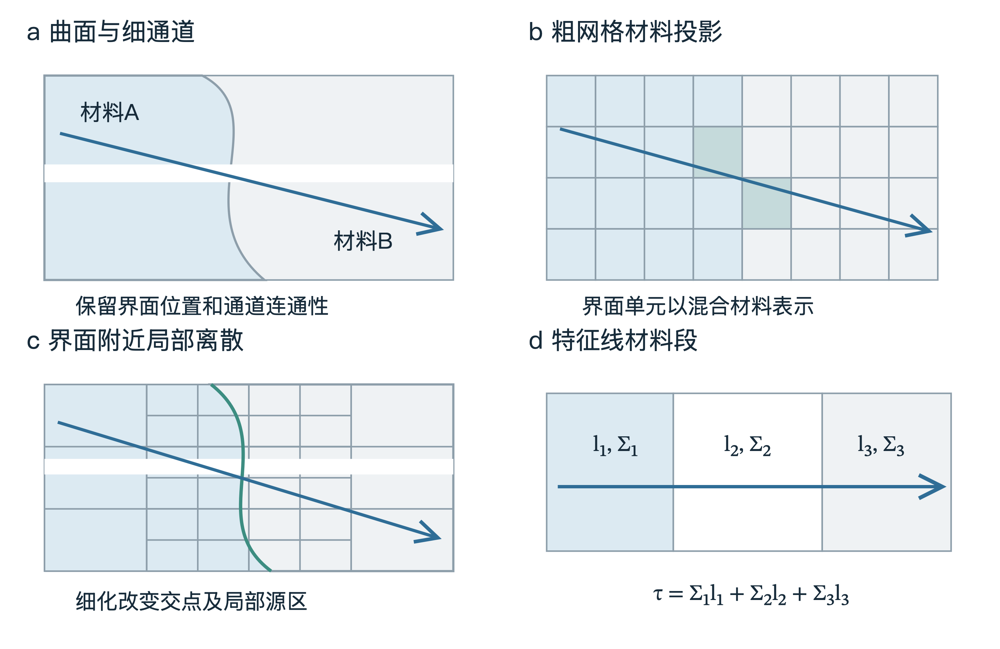
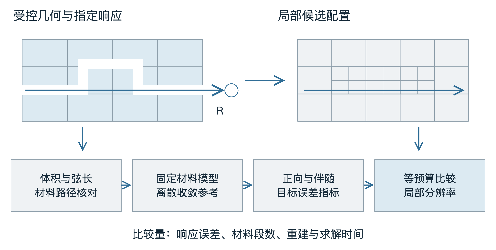
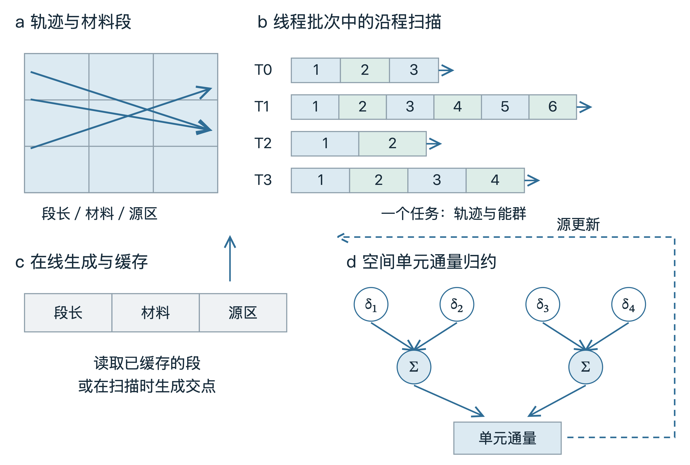
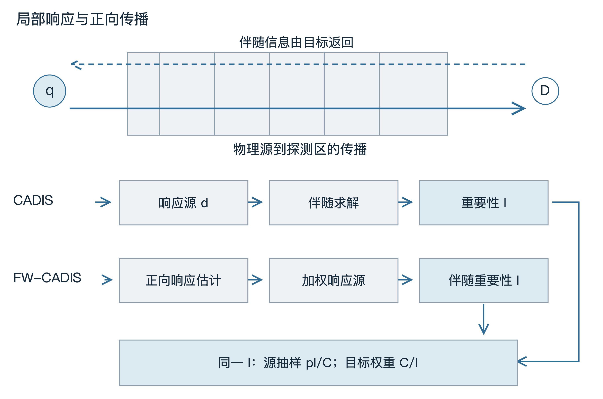
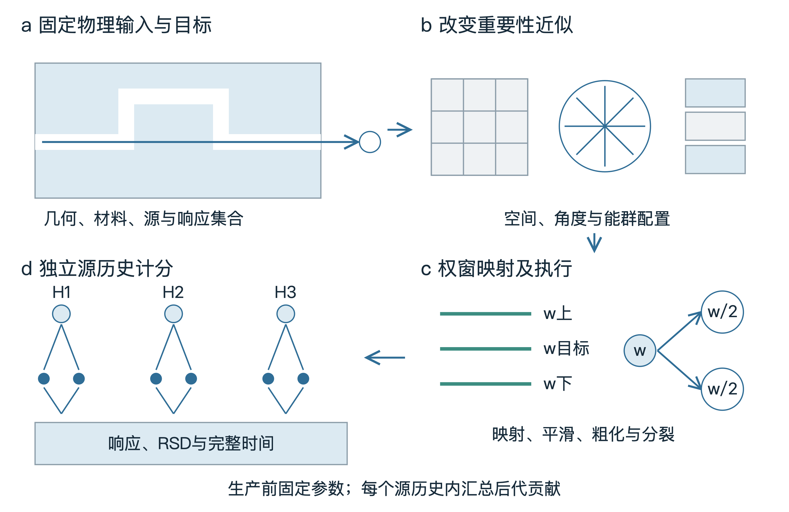
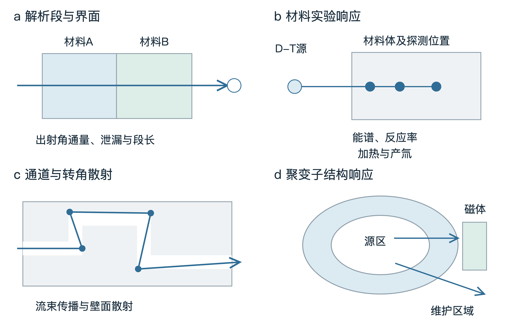

%% 文档标题 面向聚变堆屏蔽的高效中子输运与确定论—蒙特卡罗耦合减方差方法研究设想





# 第一章 研究背景与博士阶段总体研究设想

## 1.1 聚变屏蔽的工程需求与计算问题

聚变装置的屏蔽设计需要在有限的空间内同时满足磁体辐照、结构材料寿命、维护作业和氚增殖等要求。D-T反应产生的约14 MeV中子穿过第一壁、包层、屏蔽体与真空室后，可通过散射、俘获及次级粒子产生向外传递能量。超导磁体中的核热决定低温系统的附加热负荷，绝缘材料的辐照影响磁体寿命，维护区域的剂量则影响设备布置与作业安排。输运计算把几何、材料和核反应数据联系到这些可评价的工程响应，是比较屏蔽方案的基础[@r4; @r46]。

聚变屏蔽中的复杂性首先来自材料与传播路径的三维分布。薄层屏蔽、斜交界面、诊断孔道和管线穿透件同时存在，局部结构的改变可能使中子穿过不同材料，或增加经孔道及壁面散射到达外部区域的概率。对于磁体背侧和厚屏蔽后的探测位置，贡献来自穿透或散射后仍能到达目标的粒子历史。需要分辨的因此不仅是部件形状，还包括沿这些传播方向经历的材料次序和光学厚度。几何近似、空间离散与角向分辨率均会改变这部分信息。

屏蔽计算还承担反复比较设计的任务。包层与屏蔽层厚度、孔道位置、材料配比及源分布的变化，会触发几何、截面、轨迹或重要性数据的更新。工程上关心的是一个新方案何时能够获得满足精度要求的响应，以及连续修改多个方案需要多少计算资源。参数化建模与输运联用已被用于三维设计扫描[@r1]。由此，高效输运方法的研究需要同时考虑响应误差、数据准备、输运求解和设计更新，而不是只观察某个计算内核的执行速度。

## 1.2 中子输运与确定论—蒙卡方法的互补

本研究以稳态多群固定源输运为主要问题。对能群$g$，角通量$\psi_g$在给定材料中的平衡可写为

$$\boldsymbol\Omega\cdot\nabla\psi_g+\Sigma_{t,g}\psi_g=Q_g[\psi]+q_g.$$ {#eq-transport}

其中，$\boldsymbol\Omega$为运动方向，$\Sigma_{t,g}$为宏观总截面，$q_g$为外源，$Q_g$表示离散能群之间的散射和所纳入的次级粒子产生。源归一化、材料密度及边界条件共同确定输运问题。对空间区域$V_D$中的线性响应，可定义

$$R=\sum_g{\int_{V_D}{d_g(\mathbf r)\phi_g(\mathbf r)\,\mathrm dV}},\qquad\phi_g=\int_{4\pi}{\psi_g\,\mathrm d\Omega}.$$ {#eq-response}

响应函数$d_g$体现具体物理目标：区域通量取相应计分权重，反应率采用反应截面，剂量采用能量相关转换系数。核热计算将中子与光子的能量沉积纳入一致模型；产氚响应由产氚反应率积分并按物理源归一化。明确响应定义后，才可分别讨论空间误差、统计误差和计算代价。

确定论方法将空间、角度和能量离散，通过求解输运方程获得全域通量。伴随输运则提供粒子状态对指定响应的贡献，即重要性信息。蒙特卡罗方法以粒子历史抽样描述连续能碰撞和复杂几何传播，通过历史贡献的平均估计响应。两者的互补在于：确定论以较低成本提供全域传播与目标贡献的近似结构，蒙卡据此将样本投入到对目标更有贡献的状态，并以带权输运完成最终统计[@r30; @r31]。

这种互补使确定论预计算的评价目标更加具体。用于减方差的重要性场需要表达源到目标之间的贡献分布；其空间细度、角向分辨和能群配置影响采样投入的位置，也影响预计算成本。GPU并行可以缩短场求解中的部分步骤，轨迹和网格的数据组织又决定其显存与执行效率。因此，空间离散、GPU输运和自动减方差应围绕同一响应任务衔接研究。

## 1.3 总体研究问题与目标

本研究关注复杂聚变屏蔽中“哪些信息值得更精细地计算，以及这些信息怎样转化为最终响应的计算效率”。这一问题包含三个相互联系的方面：几何与材料表示如何保留薄层和孔道中的主要传播特征；GPU上的轨迹、缓存与通量累积如何利用给定空间离散；近似重要性如何经源偏倚和权窗转化为稳定的蒙卡统计。

相应的研究目标是，在明确的响应误差与资源条件下，建立空间表示、确定论执行和蒙卡统计之间可解释的联系。研究将通过受控几何与材料算例辨认误差机制，以真实实验和聚变子结构评价适用性，并比较从输入准备到响应完成的计算时间。

# 第二章 复杂几何中子输运与自适应空间离散方法

## 2.1 几何表示与材料界面处理

输运计算中的几何表示需要回答两个问题：粒子位于哪种材料中，以及沿给定方向何时进入下一种材料。CAD通常以曲面和实体边界描述设计部件，构造实体几何（CSG）以基本曲面和布尔运算定义区域。由CAD转换为输运模型时，需要把设计实体整理为无遗漏、无重叠且材料赋值明确的空间分区。Tsige-Tamirat等利用McCad生成ITER中子学模型，并以MCNP随机体积计算对照CAD体积，建立了几何转换后的定量检查途径[@r3]。

直接几何追踪将求解器中的射线求交与材料区域相联系。Chen等把MCAM的CAD建模和通用射线求交用于二维MOC，在SuperMC中采用菱形差分处理平通量近似的空间误差。其作者稿给出的ISSA两材料问题有效增殖因子与参考值相对差为−0.0106%，复杂C5G7-MOX问题的差异约为0.33%[@r8]。这项工作把CAD几何访问引入确定论轨迹扫描，使材料边界可以直接参与特征线分段；空间源近似和角向积分则由输运离散进一步控制。

非贴体方法使用独立于实体边界的背景网格，材料界面可以穿过网格内部。Yang等基于SALOME完成边界表示到CSG的转换，在笛卡儿和柱坐标单元中采用体积加权的材料均匀化，减少只以单元中心位置决定材料所造成的映射偏差[@r9]。Buchan等进一步采用supermeshing，即由实体网格与背景网格的交叠关系构造材料投影，并将守恒投影与背景有限元网格自适应结合[@r12]。两类方法都将几何生成与求解网格分开管理，区别在于混合材料参数及投影进入离散方程的方式。

材料体积分数和方向传播特征承担不同作用。一个含窄孔道的单元即使保持相同空隙体积分数，均匀混合后的材料也可能给沿孔道运动的粒子分配额外碰撞。沿某条特征线，各段的宏观总截面与长度之积累加为光学厚度；细薄高吸收层的位置和厚度会直接改变沿程衰减。图1将曲面、局部网格与材料段对应起来，说明材料投影需要同时核对体积、交点、弦长和通道连通性。

{width=15.8cm}

%% 图片题注 图1 曲面材料在非贴体网格中的表示与特征线分段。局部细化增加界面交点的分辨率；各材料段的宏观截面与长度共同确定沿程光学厚度[@r8; @r9; @r12; @r13]。

规则体素通过整数索引访问材料与源区数据，局部细化则提高指定区域的空间分辨率。块结构方法将细化单元组织成矩形块，使块内数组保持规则布局，并由层级索引处理粗细网格的关系。AMReX中的Box、BoxArray和DistributionMapping分别描述矩形区域、块集合及其并行分配，重网格时依据标记聚类形成新块，再迁移数据[@r17]。GPU自适应笛卡儿网格研究还将平衡细分、构建与更新开销作为独立问题讨论[@r18]。对中子输运，块的计算负载还与穿越特征线数量、段长分布、能群和迭代次数相联系，因此工作量估计可以超出单元数量本身。

## 2.2 MOC空间离散与目标导向自适应

MOC把指定方向的输运方程转化为沿射线的一维递推。射线与材料界面及源区边界的交点将其划分为多个段；每段需要总截面、长度和源项的近似表示。在段内截面和角源$Q$均为常数时，出射角通量由

$$\psi_{\mathrm{out}}=\psi_{\mathrm{in}}e^{-\Sigma_t l}+\frac{Q}{\Sigma_t}(1-e^{-\Sigma_t l})$$ {#eq-moc}

给出，其中$l$为材料段长，$\Sigma_t>0$。真空极限$\Sigma_t\to0$取$\psi_{\mathrm{out}}=\psi_{\mathrm{in}}+Ql$；小光学厚度下采用稳定的指数差计算。将各方向、轨迹与段内积分按求积权重汇总，可获得源区标量通量，并更新散射等源项。由此，几何交点决定材料段，源区划分决定沿程源近似，轨迹间距和角向求积决定积分分辨率。平源区的细化、沿程高阶源展开和几何边界加密分别改变这些环节。

OpenMOC将二维CSG追踪、平源MOC、源迭代与粗网有限差分加速组织为可扩展求解框架，以C5G7和LRA等问题检验本征值与功率分布[@r6]。Gaston等在MOCkingbird中采用一般非结构网格上的三维长特征线，沿完整轨迹穿越不同子域，并比较保存首次分段和逐次在线分段的组织方式[@r7]。三维网格的局部变化会增加交点、短段及跨域角通量传递，因而空间自由度与实际扫描工作量需要分别记录。

对于离散纵标法，局部网格还引入粗细界面的通量映射。Liu等2020年以多层八叉树组织非匹配笛卡儿网格，随后发展与解相关的预测—校正映射，根据通量形状和平衡信息选择跨界重构[@r13; @new_liu_mapping2021]。这一技术链表明，局部加密的实施包括网格层级、界面通量传递和扫描次序三个部分。特征线法可沿材料段递推保持入射与出射角通量的连接，采用其他界面离散时则需要相应的守恒与重构公式。

自适应的另一核心问题是依据什么量分配分辨率。标准误差指标强调全域解或局部梯度；目标导向方法使用伴随信息，把残差对探测器或积分响应的贡献作为加密依据。Wang与Ragusa在二维非结构三角形网格上比较高阶DG的标准与目标导向自适应，讨论点通量和区域平均反应率；Lathouwers针对体与表面探测器构造含角度依赖的双重加权残差及目标误差控制[@new_wang_ragusa2011; @new_lathouwers2011]。远端探测区的绝对通量可能很小，目标导向选择使误差控制与需要评价的响应直接对应。

Baker等在球谐角展开和空间子网格尺度有限元框架中，用子网格校正构造残差，并组合正向、伴随各向异性误差度量，针对两个单群和一个多群固定源屏蔽问题配置网格[@r10]。Goffin等把目标泛函扩展到有效增殖因子[@r11]。这些研究将“哪里需要分辨率”具体化为与空间格式、残差构造和目标定义相联系的数值过程。对MOC开展类似研究时，可从源区重构误差、段积分及轨迹积分残差入手，构造与其离散一致的目标指标。

Liu等的后续工作分别推进了全局与目标精度控制。2022年研究利用多层金字塔结构、空间矩比指标和扫描优化，在达到相同精度时，相对均匀细化节省60%—80%的计算成本；2023年研究以加权差分通量重构残差，并以DWR驱动多群固定源与临界问题的加密，在所测目标相近精度下减少超过70%的工作量和运行时间[@r14; @r15]。在Balakovo-3固定源剂量基准中，多层八叉树将约950万网格降至190万，对传统离散纵标计算和实验结果的RMS差异分别约为4%与10%，相对均匀细网格节省约70%计算成本[@new_liu_balakovo2023]。这些结果为采用局部配置减少达到指定响应精度所需的工作量提供了依据。

近年的发展还包括提高空间阶次。Wilson等将非连续等几何离散、目标误差度量、局部$h(p)$细化与扩散加速结合，在参考空间求解后投影形成误差估计[@r16]。这使空间配置具有改变单元尺寸和提高解表示阶次两种选择。表1按数值处理与验证结果归纳代表性工作；后续研究可以比较细化、源展开和界面重构各自减少的误差及其计算代价。

%% 表格题注 表1 复杂几何与目标导向空间离散的代表性研究

| 工作 | 对象与离散 | 数值处理 | 验证结果及启发 |
| :--- | :----- | :------- | :--------- |
| Chen；Yang[@r8; @r9] | CAD-MOC；CAD至离散纵标网格 | 通用射线求交；体积加权混合材料 | 几何边界访问与材料投影分别进入输运离散 |
| Buchan[@r12] | 内部实体与独立背景有限元网格 | supermeshing守恒投影并结合自适应 | 把实体几何分辨率与背景解分辨率分开配置 |
| Baker；Lathouwers[@r10; @new_lathouwers2011] | 固定源探测器；有限元或DG | 正伴随误差度量；含角度依赖的DWR | 按目标积分控制加密位置及停止条件 |
| Liu 2020/2021[@r13; @new_liu_mapping2021] | 八叉树非匹配笛卡儿$S_N$ | 层级扫描、预测—校正通量映射 | 局部细化同时需要粗细界面传递 |
| Liu 2022[@r14] | 多层空间矩离散 | 空间矩比指标与优化扫描 | 原测试相同精度下较均匀细化节省60%—80%成本 |
| Liu 2023 DWR[@r15] | 三维多群固定源与临界 | 加权差分重构残差及近似伴随 | 原测试相近目标精度下工作量和时间减少>70% |
| Liu 2023 Balakovo[@new_liu_balakovo2023] | VVER-1000固定源剂量 | 多层网格、源投影与跨界映射 | 约950万→190万网格；对计算/实验RMS约4%/10% |
| Wilson 2026[@r16] | 非连续等几何$S_N$ | 目标度量、$h(p)$细化与扩散加速 | 在光滑制造解中检查空间阶次，并配置目标自适应 |

%% 表注 DWR为双重加权残差；RMS为所引文献定义的均方根差异。

## 2.3 研究思路与技术路线

我拟从薄层、斜界面及直通或折弯孔道组成的受控几何入手，研究材料路径误差对目标响应的影响。先用原始几何计算材料体积、界面交点和弦长，在背景网格中改变材料投影与局部细度，比较沿选定方向的材料序列和光学厚度。随后固定同一材料模型与多群数据，逐一收敛角度、轨迹间距、源区和迭代误差，得到可用于比较局部配置的参考响应。图2给出从几何核对到目标误差评价的研究次序。

{width=15.8cm}

%% 图片题注 图2 空间离散研究的计算与比较次序。材料映射、粗细界面传递和响应误差分别核对，目标量用于选择局部分辨率[@r10; @r15; @new_liu_mapping2021]。

局部配置将比较材料界面标记、通量梯度及伴随加权指标。拟在相同单元数或预计算预算下，观察各指标选择的位置、响应误差、特征线段数和计算时间，并在粗细交界核对角通量传递与区域平衡。高分辨率优先配置在对目标贡献较大且材料近似容易改变传播的区域，局部源展开则用于减少平源近似造成的段内误差。这样可以分别辨认几何表示、界面传递和输运离散对目标的作用。

研究还将比较一次完整求解与几何局部更新的成本。对于层厚或孔道位置的变化，记录受影响网格、需重建轨迹及可保留数据，以目标误差和完整更新时间评价局部配置。预期形成材料路径误差与响应变化的对照算例，以及能够在明确预算下选择局部分辨率的指标。其在重要性预计算中的应用，将按第四章的方法继续评价权窗与蒙卡响应统计。

# 第三章 GPU加速确定论中子输运计算方法

## 3.1 MOC并行实现与轨迹数据组织

GPU-MOC将大量轨迹—能群任务分配给并行线程，在给定源项下完成沿程扫描，再汇集各空间单元的通量贡献。单条轨迹中，后一段的入射角通量来自前一段出射值，计算具有沿程次序；不同轨迹、角度或能群可提供并行任务。线程分配因而需要同时考虑轨迹数量、材料段数、能群访问和边界耦合。若同一线程束内轨迹长短悬殊，先完成的线程会等待较长任务；按段数或估计工作量分组能够减轻这种不均衡。

轨迹数据可显式保存、在线生成或部分缓存。显式保存段长、材料及源区索引，使迭代扫描直接读取数组；在线生成在扫描时重新求交，以追踪运算换取存储空间；部分缓存则保存代价较高或重复使用较多的轨迹。Song等在少群三维MOC中组合线性源、在线轴向追踪与轨迹分批，以适应单GPU显存[@r25]。Zhou等的预印本按轨迹存储代价组织缓存子集，其余在线生成[@r24]。这些策略把每次扫描的追踪工作与可驻留的数据量联系起来，也使几何更新频率成为缓存选择的依据。

在GPU-MOC计算中，不同特征线可并行完成角通量扫描，但多条轨迹对同一空间单元的通量贡献需要进行归约累积。直接原子加法能够保证并行更新的正确性，但可能因同址写入竞争而增加计算开销；线程块内局部归约可减少全局原子操作次数，同时引入额外的分组和同步成本。空间网格及轨迹组织方式会改变通量累积的竞争分布，因此归约策略也是GPU-MOC性能优化的重要环节。NVIDIA的warp聚合示例展示了由线程协作汇总更新、再由代表线程提交全局原子操作的机制，官方指南则将合并访存、数据复用、占用率和同步纳入性能分析[@r28; @r29]。图3给出轨迹、线程、缓存与通量累积的关系。

{width=15.8cm}

%% 图片题注 图3 GPU-MOC的轨迹处理与通量累积。不同线程处理轨迹—能群任务，沿轨迹递推后汇集空间单元贡献；缓存、分组与局部归约共同改变访存、竞争和同步开销[@r20; @r21; @r24; @r25; @r26; @r27; @r28]。

早期OpenMOC已经比较二维轨迹扫描的GPU实现。Boyd等分别测试GeForce GTX 480、Quadro 4000、Tesla C2070和Tesla K20c，在其组件问题中，GTX 480相对单Intel Xeon核的求解加速接近50倍[@r6]。宋佩涛的学位研究进一步把二维及MOC-EX实现、性能模型、CPU/GPU任务分配与CMFD结合[@r19]。其2019年期刊工作针对MPI通信与GPU扫描的重叠，在每节点两块Tesla K80、五节点共20个逻辑GPU的系统上，将强并行效率由87%提高至95%[@r20]。这里改进的是异构程序中的通信等待和工作分配。

负载模型也推动了大规模三维并行。Wang等在轴向挤出几何上采用循环轨迹分解，以更细的任务粒度替代单纯角度分解，通过组合模型估计轨迹工作量并安排分区，在ORISE上从10240扩展至98304个CPU核时保持超过40%的并行效率[@r23]。汪岸的学位研究进一步推导周期几何中的轨迹长度分布，并将几何建模、并行分配及验证组织到ANT-MOC中[@r22]。Li等SC23工作将存储、计算与通信模型用于三级负载映射，在[“东方”超算的16000个DCU](https://cnic.cas.cn/kxyj/kyjz/202307/t20230707_6807109.html)上报告70.69%的强扩展和89.38%的弱扩展效率[@r21]。这些研究把负载估计由轨迹数量推进到轨迹长度、存储需求和通信关系。

## 3.2 GPU计算性能与正向—伴随输运

三维求解中的显存占用包括轨迹段、源项、标量与角通量、散射矩、边界数据及迭代工作区。对轴向挤出问题，在线轴向追踪利用径向轨迹与轴向平面的交点生成三维段；分批扫描则控制同时驻留的轨迹数据。Song等在C5G7组件中将显存需求降低98.5%，并以蒙卡生成的四群截面开展单GPU的SMR全堆芯计算[@r25]。其方法贡献在于空间源表示、追踪和轨迹批次的联合配置。

Dzianisau与Lee在STREAM3D-GPU中结合MOC/DD、轴向分解和异步执行，正式期刊结果给出每个MPI进程的GPU存储由理论约50 GB降至4.5 GB以下，8和16个GPU的MOC/DD求解分别较128核CPU参考快22.1和40.5倍[@r26]。独立的2024年KNS先行稿采用8块RTX A5000及两颗EPYC 7543、共64个CPU核，在其C5G7测试中分别列出扫描时间和总时间[@new_stream_kns2024]。将不同版本的算例、硬件和计时分开记录，可以进一步分析存储削减、源更新与异步执行各自贡献。

NuDEAL展示了不同离散共用GPU基础设施的另一种组织方式：在轴向挤出几何上采用MOC/HFEM及DGMOC，在一般多面体网格上采用DFEM-$S_N$，并通过角通量压缩与方位角顺序扫描控制工作区[@r27]。其3D C5G7的DGMOC测试在RTX 2080 Ti上将角度分成2块与32块，存储分别约2589 MB和7133 MB，单次扫描时间分别为5.25 s和5.09 s。该对照直接展示了存储容量与扫描粒度的取舍。其二维DFEM-$S_N$的Concurrent和Sequential组织在RTX 4070 Ti上分别给出26 s与148 s总计算时间，反映了任务并发对同一框架执行的影响。

固定源研究提供了与屏蔽更接近的计算对象。STRAUM采用GPU群块Krylov迭代和空间波前依赖调度，处理Kobayashi类问题及压力容器屏蔽。其压力容器模型在177575个网格上，优化群块后RTX 3080 Ti和RTX 4090的计算时间分别为734 s和379 s；GPU采用FP32，串行Ryzen 9 7900X参考采用FP64及相应群迭代配置[@new_straum2025]。较早的Sweep3D研究则显示，通量修正会改变GPU执行代价：Tesla M2050对Xeon X5670的整体比值在无修正与有修正设置下分别为2.56和1.23[@new_gong2011]。数值处理、精度和迭代组织因此与硬件共同决定性能。

GPU输运还覆盖时间依赖与大型工程求解。Zou等在ALPHA中实现全隐式瞬态固定源MOC，采用棒级CMFD，以C5G7-TD和MPACT作结果对照，并研究FP32及MOC收敛容限[@new_zou2022]。Denovo则以GMRES和空间—角度—能量并行求解大型固定源问题，在Titan的K20x节点上用于JET中子学[@new_denovo_fusion2018]。这两类研究分别提供源随时间更新和大规模外源传播的实现参照。表2将计算对象、算法组织及对应结果放在同一比较框架中。

OpenSn为非结构多面体网格建立多群$S_N$/间断有限元求解框架，覆盖稳态、本征值与离散伴随问题[@new_opensn2026]。在2026年11月6日的[公开源码版本1.0.1](https://github.com/Open-Sn/opensn/tree/f903a0d71cb8d130dc104f85d9d9ae66fd79146b)中，Cartesian坐标、标准角算子和等权反向角求积下的伴随模式，通过转置散射及产生矩阵形成源矩，再将源矩传入GPU扫描路径并处理伴随角通量方向。这一实现为正向—伴随共用数据结构与扫描接口提供了具体参照。

Pryer的近期预印本将固定源DG波前扫描组织为GPU张量程序，并在网格面流向符号保持不变的分支中，用反向自动微分计算吸收体遮蔽响应的导数。其RTX A4000平台采用$Q_1$离散和$128\times128$网格，对2048个样本按每批128个进行反向计算；另以独立装配的正向和转置块系统，在$8\times8$至$32\times32$网格上，对探测器电流、区域平均通量和吸收响应作双精度核对，报告一致性达到双精度舍入量级[@new_pryer_wavefront2026]。这一数值检验为共享扫描结构的离散伴随作用提供了参照。混合生产流程也可按任务分工：Biondo等所述Shift版本在CPU上完成Denovo正向—伴随、权窗生成及源偏倚，在GPU上执行蒙卡输运与权窗控制[@new_shift_gpu_status2025]。

%% 表格题注 表2 并行MOC及GPU固定源输运的算法与计算结果

| 工作 | 计算对象 | 算法组织 | 主要结果与计算条件 |
| :--- | :----- | :------- | :--------- |
| OpenMOC[@r6] | 二维组件输运 | 轨迹/能群并行与CUDA扫描 | GTX 480对单Xeon核的求解加速接近50倍 |
| 宋佩涛等[@r20] | 二维异构并行MOC | MPI通信与GPU扫描重叠 | 5节点20个K80逻辑GPU：强扩展效率87%→95% |
| ANT-MOC[@r21] | 直接三维堆芯输运 | 三级负载映射及存储/通信模型 | 16000个DCU：强/弱扩展效率70.69%/89.38% |
| Wang等[@r23] | 挤出几何三维CPU并行 | 循环轨迹与组合负载分配 | 10240→98304 CPU核，原测试并行效率>40% |
| Song等[@r25] | 少群三维组件/SMR | 线性源、在线轴向追踪、分批 | 组件显存降低98.5%，支持单GPU四群全堆芯 |
| STREAM3D-GPU[@r26] | OPR-1000三维MOC/DD | 轴向分解与异步执行 | 8/16 GPU对128核CPU求解22.1/40.5倍；每进程<4.5 GB |
| NuDEAL[@r27] | DGMOC及DFEM-$S_N$ | 角通量压缩与角度分块 | 3D C5G7，RTX 2080 Ti：2/32角块2589/7133 MB，单扫5.25/5.09 s |
| STRAUM[@new_straum2025] | 压力容器固定源 | 群块Krylov、空间波前 | 177575网格：3080 Ti/4090为734/379 s；FP32 GPU对FP64 CPU配置 |

伴随输运将目标响应作为源，其计算需要转置散射和能群耦合关系，并按流入、流出边界的对偶关系组织空间传播。对实数离散矩阵$A$及由正体积、正求积权等构成的对称正定内积矩阵$W$，离散伴随满足

$$A^\dagger=W^{-1}A^\mathsf{T}W,\qquad\langle Au,v\rangle_W=\langle u,A^\dagger v\rangle_W.$$ {#eq-duality}

实现时可共享材料、轨迹及源区索引，将正向散射源更新替换为对应转置运算，并使轨迹传播和边界数据交换服从伴随次序。可用内积对偶关系和源—响应互易关系检查离散实现，再将得到的重要性场用于第四章的权窗计算[@r31; @r40]。这一过程把GPU执行优化与正向、伴随两种任务的数值正确性连接起来。

## 3.3 研究思路与技术路线

我拟以可修改MOC求解器为基础，先完成多群固定源和离散伴随的实现核对，再围绕图3中的追踪、扫描、归约与源更新开展性能分析。解析材料段用于检查递推与交点，散射和多群问题用于核对源更新，正向—伴随内积及响应恒等式用于核对算子。CPU和GPU在相同物理模型及收敛要求下比较局部响应、守恒量和浮点精度敏感性。

性能研究将网格与轨迹组织一并作为变量：在均匀和局部细化网格上，分别比较显式、在线及部分缓存，随后按段数或测得工作量分组，比较直接原子累加与线程块内局部归约。记录扫描所处理的段数、有效带宽、线程工作分歧、归约同步、临时工作区和峰值显存，以解释每种组合的时间变化。测量包括完成全部迭代所发生的追踪、源更新、传输和输出，并单列正向与伴随任务。

进一步拟区分源变化、材料变化和几何变化三种更新条件，研究轨迹缓存的复用及失效范围。预期建立由段数分布、显存预算和更新频率解释的执行选择方法，并给出经验证的固定源正向—伴随计算模块。

# 第四章 确定论—蒙特卡罗耦合减方差方法

## 4.1 伴随驱动的源偏倚与权窗

减方差的目标是用有限粒子历史获得所需响应的统计精度。源偏倚改变粒子出生状态的抽样概率；分裂增加对目标有贡献的粒子分支数量；俄罗斯轮盘减少低贡献粒子的后续计算。每项操作均通过权重修正，使保留历史在期望上代表原来的物理源。权窗以空间和能量区间规定粒子的适宜权重范围，为输运中的分裂和轮盘提供依据。

伴随输运为这种资源分配提供目标相关信息。令$\mathcal L$为线性固定源输运算子，$q$为物理源，$d$为目标响应函数；在配对边界条件下，正向与伴随问题满足

$$\mathcal L\psi=q,\qquad\mathcal L^\dagger\psi^\dagger=d,\qquad R=\langle d,\psi\rangle=\langle q,\psi^\dagger\rangle.$$ {#eq-adjoint}

这里的内积包含空间、能量和角度积分。伴随角通量$\psi^\dagger$描述某一位置、能量和方向上的粒子对指定响应的期望贡献。Wagner与Haghighat利用离散纵标伴随解，为蒙卡构造一致的源偏倚和权窗，形成CADIS方法[@r30]。Munk与Slaybaugh的综述将此类确定论驱动方法与蒙卡迭代、角度相关方法纳入共同的技术谱系[@r32]。

为区分物理源强与抽样概率，设$\int{p(x)\mathrm dx}=1$，$x$表示被偏倚的源变量，$I(x)$为源支持集上的正重要性近似。定义

$$C=\int{p(x)I(x)\,\mathrm dx},\qquad\widehat p(x)=\frac{p(x)I(x)}{C},\qquad w_0(x)=\frac{p(x)}{\widehat p(x)}=\frac{C}{I(x)}.$$ {#eq-cadis}

按$\widehat p$抽样后，以$w_0$修正出生粒子的权重，计算结果再按物理源强归一化。重要性较高的源状态被更频繁地抽样，同时赋予较小权重。输运权窗的目标权重也由同一$I$的倒数确定，使出生权重与沿程权重控制相互一致；上下限和存活权重由具体程序的窗宽约定设置。MAVRIC中的Denovo—Monaco流程实现了这一关系[@r40]。

对多个探测器或大范围计分，FW-CADIS利用一次正向计算估计各目标的响应，并以这些估计调节伴随源[@r31]。对于预先给定的响应函数$d_i$、正的估计$\widetilde R_i$及无量纲优先级$\beta_i$，可以对归一化目标$\sum_i{\beta_iR_i/\widetilde R_i}$构造

$$d_{\mathrm{FW}}=\sum_{i=1}^{N_D}\frac{\beta_i}{\widetilde R_i}d_i.$$ {#eq-fw}

预计响应较低的目标因而获得较高的伴随源权重。不同目标仍按各自响应定义计分；用于全局通量、区域剂量或探测器能谱的伴随源，应与对应的空间和能量权重一致。图4比较单目标CADIS和正向加权FW-CADIS的计算次序，以及二者共同的源偏倚与权窗关系。

{width=15.8cm}

%% 图片题注 图4 CADIS与FW-CADIS的重要性生成及一致偏倚。单目标采用对应响应源；多目标先由正向估计构造加权伴随源，再用同一重要性设置出生抽样和输运目标权重[@r30; @r31; @r40]。

角度相关方法进一步处理同一空间—能量状态中方向不同的贡献。Munk等在CADIS-Ω中以正向角通量加权伴随角通量，构造

$$I_{\Omega}(\mathbf r,E)=\frac{\int_{4\pi}{\psi(\mathbf r,E,\boldsymbol\Omega)\psi^\dagger(\mathbf r,E,\boldsymbol\Omega)\,\mathrm d\Omega}}{\int_{4\pi}{\psi(\mathbf r,E,\boldsymbol\Omega)\,\mathrm d\Omega}}.$$ {#eq-omega}

该量是在有正向通量的状态上定义的角度加权标量重要性，能够把前向流束与目标贡献的方向关系引入空间—能量权窗[@r44]。

在Munk等的混凝土迷宫算例中，直接MC、CADIS和CADIS-Ω的MC-only FOM分别为493、5.1和145 min⁻¹。作者通过第26群（$10^{-11}$—$10^{-8}$ MeV）的重要性分布说明：孔道出口至探测器的狭小方向范围主导该群贡献，普通标量伴随在探测器附近却较为对称，使分裂和轮盘的投入偏离主要流束。CADIS-Ω用正向角分布加权伴随贡献，改变了空间—能量权窗的分配。第11群（$2.9\times10^{-5}$—$1.01\times10^{-4}$ MeV）的粒子可经孔道或屏蔽到达探测器，局部方向性较弱。CADIS-Ω相对CADIS改善了低能区统计，能谱误差分布也更均匀；直接MC虽然汇总FOM较高，仍有能区未达到作者要求的统计精度[@r44]。该研究把重要性构造与具体响应所敏感的能区和方向联系起来：正向角通量表示实际粒子分布，伴随角通量表示对应状态的目标贡献，两者共同调节标量权窗的统计投入。

Zhao等的LAA-CADIS采用局部角度适应，面向复杂通道改进重要性配置[@r34]。这两类研究使角向信息的作用可以通过流道中的传播方向、探测器能区和权窗执行分别考察。

多步骤响应则需要在不同物理阶段之间传递重要性。MS-CADIS针对停堆剂量，沿中子照射、活化和衰变光子输运的联系，将最终剂量的重要性传回中子抽样阶段[@r33]。其关键是按最终响应分配前一步的统计投入。对瞬发核热、运行剂量和冷却后的停堆剂量，需要分别选取相应的响应链和核数据。

## 4.2 重要性生成、权窗优化与计算效率

自动权窗既可由近似输运解生成，也可由蒙卡逐次探索形成。Davis与Turner将MAGIC用于ITER全局分布计算，通过已有蒙卡通量与统计信息迭代更新重要性和权窗[@new_magic2011]。随机射线方法则在多群、固定源区表示下随机选取起点和方向，沿射线积分并迭代通量；正向及伴随场可以用于CADIS/FW-CADIS。OpenMC现行流程同时提供MAGIC和内置随机射线权窗生成，支持在同一几何中组织预计算与生产输运[@r41]。表3比较这些方法所需信息与对应响应。

%% 表格题注 表3 自动减方差方法的信息来源与响应构造

| 方法 | 重要性信息来源 | 对应响应 | 主要计算步骤 |
| :--- | :----- | :------- | :--------- |
| CADIS[@r30] | 目标响应的伴随场 | 单个或明确局部响应 | 响应源→伴随→一致源偏倚与权窗 |
| FW-CADIS[@r31] | 正向响应加权的伴随场 | 多探测器、区域或全域 | 正向估计→加权响应源→伴随→权窗 |
| CADIS-Ω[@r44] | 正向角通量加权伴随 | 局部方向性贡献 | 正/伴随角信息→替代标量重要性 |
| LAA-CADIS[@r34] | 局部角度自适应 | 复杂通道响应 | 按局部方向贡献改善重要性 |
| MS-CADIS[@r33] | 跨物理步骤的伴随联系 | 指定冷却时刻停堆剂量 | 衰变光子目标→活化→中子重要性 |
| MAGIC[@new_magic2011; @r41] | 前次蒙卡通量及统计信息 | 全局粒子分布 | 探索输运→更新权窗→继续迭代 |
| 随机射线CADIS/FW-CADIS[@r41; @r42] | 多群随机射线正向/伴随场 | 局部或全局响应 | 源区与MGXS准备→射线迭代→一致偏倚 |

%% 表注 MGXS为多群截面。随机射线是场求解方式，可用于构造CADIS或FW-CADIS重要性。

空间配置是连接近似场与蒙卡执行的另一环节。Ibrahim等通过材料宏观化、确定论网格细化和权窗网格粗化，使确定论解在重要区域保留分辨率，并控制蒙卡权窗的存储规模[@r36]。求解网格用于计算近似场，权窗网格用于粒子查询及分裂轮盘，二者可以依据各自任务配置。国内郑华庆等将自动网格与权窗平滑用于复杂屏蔽；NECP-MCX集成NECP-Hydra正向—伴随求解，后续研究按贡献理论粗化笛卡儿及嵌套权窗网格[@r37; @r38; @r39]。Zhang等在cosRMC中以八叉树材料网格、邻接关系及响应矩阵构造多层权窗，同时优化并行内存配置[@r47]。

平滑、粗化和角向细化改变的是重要性在不同阶段的表示。材料均匀化会改变低密度通道的光学厚度，角向求积影响流束分辨，权窗映射则决定粒子跨界时看到的权重变化。空间网格细化可改善界面表示，源展开可改善单元内通量分布，局部角度适应可增加重要方向的分辨率。THETA近期将线性源用于随机射线屏蔽计算，在Kobayashi和ASPIS铁屏蔽等测试中，以更粗的源区保持精度；其摘要报告相对平源方案内存降低超过一个数量级、计算时间接近减半[@new_theta2026]。这为重要性预计算提供了除单纯细网格之外的空间表示选择。

Raffuzzi等在SCONE中实现随机射线CADIS/FW-CADIS，并与MAGIC及直接蒙卡比较整体屏蔽和源—探测器问题[@r42]。在其2 m混凝土整体屏蔽例中，提高多群数据、空间源阶或散射阶的保真度没有增加权窗带来的统计收益，作者将这种差异与极低权重粒子引起的过度分裂联系起来。其全局比较同时给出只计蒙卡时间和加入权窗生成时间的FOM，能够直接观察重要性生成成本。局部源—探测器比较生成权窗约需2—4 min，该局部比较的FOM以蒙卡生产时间计，不含这部分预计算。表4保留这些不同计时定义下的代表性结果。

%% 表格题注 表4 重要性近似与权窗执行的代表性数值证据

| 研究及算例 | 比较内容 | 原文结果 | 对应的计算环节 |
| :--- | :----- | :------- | :--------- |
| CADIS-Ω混凝土迷宫[@r44] | 直接MC、CADIS、CADIS-Ω | MC-only FOM依次为493、5.1、145 min⁻¹；Ω使能谱误差分布更均匀 | 正向角通量加权的空间—能量重要性 |
| MS-CADIS停堆剂量[@r33] | 相对标准全局减方差 | 摘要报告中子MC阶段效率约550倍 | 以最终剂量为目标分配中子阶段历史 |
| Raffuzzi整体屏蔽[@r42] | RR-FW-CADIS与MAGIC，20次独立完整运行 | 仅MC FOM：1.08±0.14/0.80±0.30；含WW生成：0.96±0.12/0.37±0.14 | FOM单位为min⁻¹；同一全局相对方差定义 |
| Turner与Davis长历史[@new_longhistory2013] | 动态窗参数$M$ | $M=10^5$时pFOM 0.00519，$M=10^9$时0.00081 min⁻¹ | pFOM同时计入粒子统计与并行执行效率 |
| THETA线性源随机射线[@new_theta2026] | 线性源相对平源求解 | 摘要报告内存降低>10倍、时间接近减半并保持精度 | 确定论型场求解的源阶/网格配置 |
| Shift先进架构[@r43] | CPU历史型与GPU事件型权窗输运 | Frontier两例在20节点上MC运行<2 min；每GCD吞吐为最佳CPU实现9—11倍 | GPU计算芯片GCD的粒子执行与队列调度 |

%% 表注 各行FOM按原研究分别定义。长历史pFOM使用全网格平均相对误差及并行机时；CADIS-Ω列为单响应MC时间指标。Raffuzzi的±为20次完整运行间的标准差，WW为权窗。

粒子执行成本还取决于权窗引起的分裂规模。一条较大权重历史进入较低目标权重区域时，可以产生大量后代；其他并行任务完成后，尚未结束的长历史可能延长墙钟时间。Turner与Davis据此提出动态调整该历史权窗的长历史处理，并以包括并行效率的指标评价参数[@new_longhistory2013]。Evans等则在Shift中比较CPU历史型线程和GPU事件型执行，使权窗控制与不同硬件上的粒子队列相适应[@r43]。这里需要同时观察方差、每条源历史的工作量与并行尾部等待。

对单个响应，常用蒙卡效率和完整计算时间可分别表示为

$$\mathrm{FOM}_{\mathrm{MC}}=\frac{1}{\mathrm{RSD}^{2}T_{\mathrm{MC}}},\qquad T_{\mathrm{all}}=T_{\mathrm{prep}}+T_{\mathrm{det}}+T_{\mathrm{WW}}+T_{\mathrm{MC}}+T_{\mathrm{IO}}.$$ {#eq-cost}

其中，$T_{\mathrm{prep}}$包含实际发生的几何和核数据准备，$T_{\mathrm{det}}$包含所需正向与伴随求解，$T_{\mathrm{WW}}$为映射、生成与处理权窗的时间，$T_{\mathrm{IO}}$为输出和数据管理时间。各项按实际边界计时，避免重复累计。全局评价还需指定计分集合、相对方差的汇总方式和零计分处理；生产输运中的原始源历史是统计单位，其分裂后代的贡献在同一历史中汇总。这样可以把重要性生成、权窗执行和最终响应可靠性放在同一评价中。

## 4.3 研究思路与技术路线

我拟从可复现的CADIS/FW-CADIS与MAGIC流程出发，研究在给定计算预算下，重要性场的哪些空间和角度特征最能改善目标统计。先固定物理几何、材料、源和响应集合，在材料多群截面及其生成约定一致的条件下，分别改变源区细度、角向配置和源展开。每次记录重要性沿主要通道的分布、权窗存储、粒子权重与源历史工作量，再比较局部响应的RSD和完整达标时间。图5给出分层试验路线。

{width=15.8cm}

%% 图片题注 图5 耦合减方差研究的分层试验。重要性场与权窗分别配置，生产计分前固定参数，按原始源历史汇总子粒子贡献，并比较响应统计与完整计算时间[@r36; @r39; @r41; @r42; @r43; @new_longhistory2013]。

随后固定预计算场，比较权窗映射、粗化和平滑，检查细小通道的查询覆盖以及跨界权重变化。拟以材料驱动配置、贡献粗化和局部角度方法为直接参照，研究保护通道传播特征与减少无效细化的组合。近零重要性区域采用保持源抽样覆盖的正下限，并核对分裂的权重总和及轮盘存活权重；全局统计同时记录关键探测器、非零计分比例和达到预设RSD要求的区域比例。

正式比较前固定权窗及参数，将生成、调参与生产计分分开记录。达标时间采用预先指定的误差与稳定性规则，并以独立完整重复计算核查均值和方差。再通过源更新、材料更新及孔道移动组成的序列，考察哪些重要性或轨迹数据可以复用、何时需要重新计算。预期形成重要性近似、权窗表示与统计成本之间的实证关系，并据此发展适合选定聚变屏蔽任务的配置或更新方法。

# 第五章 面向聚变堆屏蔽的高效中子输运及耦合应用

## 5.1 屏蔽基准与聚变工程研究

实验基准提供了从物理模型到可测响应的检验。SINBAD由NEA与RSICC共同维护，覆盖反应堆、聚变和加速器屏蔽；2025年发布的第二版包含105项基准，并通过NEA GitLab维护数据和条目版本[@r45]。对于本研究，FNS材料实验和孔道实验分别提供高能中子在实体材料中衰减与在低密度通道中传播的对象，可以将空间与角度近似放到不同物理条件下考察。

Ebiwonjumi等采用OpenMC 0.14.1-dev分析FNS钨、钒和铍组件，使用约14 MeV D-T源，以能谱、反应率、光子加热和产氚率与实验及MCNP 6.2比较[@r4]。钨例采用Denovo/MAVRIC生成的权窗，钒和铍例按较小组件直接开展计算；输运核数据使用ENDF/B-VII.1，相应剂量学反应使用IRDFF截面。光子谱按探测器能量分辨展宽后比较。表5列出其产氚和加热响应的整体C/E结果，其中C/E指计算值除以实验值，所附离散度为不同测点C/E的标准差。

车锐等用cosRMC对FNS-Duct和FNS-W建立三维模型，采用中子—光子耦合及栅元重要性减方差，比较不同穿透深度的中子通量谱。其cosRMC与MCNP5差异位于文中三倍相对统计误差带内，并另与基准实验谱进行比较[@r5]。FNS-Duct的折弯通道适于检验流束及壁面散射，FNS-W则反映高原子序数材料中的能谱变化。Iwamoto等用PHITS与JENDL-4.0重新计算FNS铁体，报告不同深度积分中子产额的C/E为1.15—1.78[@new_phits2023]。

设施级研究进一步将响应放在真实设计位置。Ibrahim等在ITER模型中计算环向场线圈核热、生物屏蔽外剂量和全局通量，以局部CADIS和全局FW-CADIS分别服务于这些目标；其剂量例的MC FOM相对直接输运提高约$2.1\times10^4$[@r35]。后续网格适应研究在两次均为10天、权窗存储约0.21 GB的MCNP计算中，将非零计分比例由79.3%提高到97.8%，对应非零计分元素数相对增加23.3%[@r36]。该非零计分覆盖指标用于评价设施范围的统计探索，区域剂量与线圈核热仍按各自响应定义计分。

CFETR研究将磁体辐照与局部屏蔽改进联系起来。Lu等基于大、小半径7.2 m和2.2 m的工程设计，经McCad构建MCNP模型，在200 MW至1.5 GW聚变功率范围评价环向场线圈核热和快中子注量。其MAGIC—密度降低组合先在较低密度下形成权窗，再逐步恢复实际密度；线圈响应在最终物理密度下计算，偏滤器屏蔽经优化后满足文中采用的ITER设计限值[@r46]。Zhang等的cosRMC工作则在CFETR 22.5°扇区应用多层自适应权窗，报告统计相对误差小于10%的网格占93.33%[@r47]。

大型确定论固定源计算也已进入聚变装置分析。Denovo的JET模型采用88080384个单元、32能群、$P_3$散射展开和每卦限256方向，在2048个Titan节点上记录4.6 h墙钟时间；每节点配备K20x GPU[@new_denovo_fusion2018]。

参数化设计展示了响应之间的取舍。Moreno等以ParaStell生成WISTELL-D的99组包层—高温屏蔽配置，用OpenMC统计氚增殖与磁体总核热。原文测试中的厚型、增殖层占比60%设计点，在2113 MW聚变源功率下得到TBR为1.10、磁体总核热为152.0 kW[@r1]。较早的CIT试验大厅研究则以三维MC—二维离散纵标结果校准一维模型，迭代选择混凝土组成和厚度，在满足屏蔽及结构约束的方案中获得约14%的造价降低[@r2]。

%% 表格题注 表5 聚变屏蔽基准与工程研究的对象和结果

| 研究对象 | 计算方法与条件 | 评价响应 | 代表性结果 |
| :--- | :----- | :------- | :--------- |
| FNS钨/钒/铍[@r4] | OpenMC、ENDF/B-VII.1；约14 MeV源；钨例用Denovo权窗 | 能谱、反应率、GHR、TPR | 9个TPR测点平均C/E=1.03±0.20；7个GHR测点0.95±0.14 |
| FNS-Duct/FNS-W[@r5] | cosRMC中子—光子；栅元重要性；MCNP5与实验对照 | 各深度中子通量谱 | 程序间差异在原文3倍统计相对误差带内，另与实验谱比较 |
| FNS铁体[@new_phits2023] | PHITS/JENDL-4.0；直径1 m、厚0.95 m铁体 | 0.003—10 MeV积分中子产额 | 六位置C/E为1.15—1.78；表列不确定度为计数统计 |
| ITER多响应[@r35] | CAD蒙卡与CADIS/FW-CADIS | TFC核热、屏蔽外剂量、全局通量 | 剂量例MC FOM相对直接输运提高约$2.1\times10^4$ |
| ITER自适应剂量图[@r36] | 同为10天MCNP、约0.21 GB权窗 | 设施网格非零计分覆盖 | 79.3%→97.8%；非零计分元素数量相对增23.3% |
| CFETR线圈[@r46] | McCad/MCNP；MAGIC与密度降低；200 MW—1.5 GW | 线圈核热和快中子注量 | 偏滤器屏蔽优化后满足论文采用的ITER限值 |
| CFETR 22.5°扇区[@r47] | cosRMC多层响应矩阵权窗 | 网格通量统计精度 | 相对统计误差<10%的网格占93.33% |
| WISTELL-D设计扫描[@r1] | ParaStell/DAGMC/OpenMC；99组；2113 MW源 | TBR与磁体总核热 | 原测试厚型/60%增殖层设计点：1.10、152.0 kW |
| CIT试验大厅[@r2] | MC—二维$S_N$校准一维模型；材料/厚度迭代 | 屏蔽及结构约束下造价 | 相对基准造价降低约14%，约410万美元 |

%% 表注 GHR为光子加热响应，TPR为产氚率。FNS平均C/E的±为测点间标准差，非单次蒙卡计分误差。TFC为环向场线圈。

## 5.2 工程响应、误差来源与方案更新

表5中的工程与实验研究涉及不同计分对象，实际应用需要预先明确响应的位置、物理权重和归一化。磁体总核热是整个区域的能量沉积积分，局部热功率密度则需要保留空间峰值；快中子注量和绝缘剂量对应不同能量权重；维护区的瞬发剂量与冷却后的停堆剂量还涉及不同源项。FNS实验中的每源粒子结果可与测量归一化比较，工程功率和注量再按物理源强及运行时间换算。因此，全局通量图、指定探测器和磁体局部计分应分别设置精度目标，并在同一模型中检查。

误差评价将物理偏差与抽样不确定度分开报告。FNS研究中，钒的低能中子谱、钨的部分阈反应和近源加热存在不同程度的C/E偏差，其变化与核数据、探测器、源表示和测量条件有关[@r4]。对数值方法的比较可以固定这些输入，观察空间与角度配置引起的响应变化；与实验比较时，则保留材料成分、源谱、探测器响应和实验不确定度。这样的安排可以把算法改进对应到具体误差来源。

对图6各层次对象的方案更新，需要依据数据的物理依赖关系处理。几何不变时，改变外源主要影响正向场及源偏倚；在固定输运算子和单一目标下，伴随解可继续表示该目标的重要性。FW-CADIS的加权伴随源还依赖正向响应。改变材料会改变截面与输运算子，移动孔道则同时改变交点和传播路径。拟分别记录源、材料和几何三类更新的数据重建范围，以实际完成各方案响应所需的时间评价复用收益。

## 5.3 应用研究思路与验证方案

拟按图6所示的对象层次建立算例。先以解析材料段和可计算交点的几何核对特征线及材料映射，再采用均匀体、多层材料和直通或折弯孔道，分别改变层厚、界面倾角、孔道宽度和弯折位置。各算例固定物理源与响应，先完成所采用空间、角度和能量配置的收敛比较，再将直接蒙卡、MAGIC及适合该目标的混合方法放在一致输入下评价。

{width=15.8cm}

%% 图片题注 图6 从材料段到聚变子结构的验证对象（原理示意图）。材料实验比较能谱、反应率、核热和产氚，孔道比较流束传播，工程模型评价磁体与维护区域响应[@r4; @r5; @r35; @r45; @r46]。

随后选取可获取输入的FNS材料与通道基准，保存条目版本、材料密度和成分、源谱与角分布、核数据库、反应截面及探测器定义。能谱比较使用相同能区划分和相应探测器分辨，反应率与核热按一致的每源粒子及质量或体积归一化。对每个响应给出C/E、实验不确定度和蒙卡统计误差，并以独立程序结果作交叉比较。数值收敛、程序交叉与实验符合度各提供一层证据。

工程应用拟以磁体屏蔽或维护孔道子结构为对象，比较源、材料/层厚和孔道更新。各方法统一响应精度、计分规则与资源预算，记录首次准备、重建及达标时间，形成可复现算例。

# 6.候选方案

## 6.1 复杂几何与重要性导向空间离散

我拟研究薄层、斜界面和窄孔道的材料表示如何影响目标响应及重要性场，并据此选择局部分辨率。最接近的基础是目标导向网格、非匹配界面传递以及材料驱动的多层权窗。拟从可解析交点的受控几何入手，将材料路径误差与给定模型上的输运离散误差分别测量，再比较材料标记、通量指标和伴随加权指标在相同预算下选择的细化位置。

预期成果是能够解释响应变化的局部误差指标、相应自适应配置方法及复现算例。该方向需要可修改的网格、材料映射和正向—伴随接口；对薄通道和界面位移的测试可先在成熟求解器中开展。候选假设是，对目标贡献较大且容易被材料近似改变的路径给予额外分辨率，可以用较少的空间工作量获得所需响应精度。

## 6.2 GPU确定论正向—伴随输运

我拟研究复杂轨迹的段数分布、缓存容量和更新频率如何共同影响GPU正向—伴随预计算。路线是先在可修改MOC代码中完成固定源与伴随核对，再剖析追踪、扫描、通量累积及源更新的时间和显存。对在线、显式及部分缓存策略，结合按工作量分组和局部归约开展对照，建立由实际访问与工作量解释的配置方法。

预期成果是经数值验证的正向—伴随模块、轨迹与执行成本模型，以及在不同显存和更新条件下的执行选择依据。该方向依赖源码、GPU时段和性能分析条件，也需要系统学习CUDA、并行调试及MOC伴随离散。候选假设是，将段数分布与数据复用次数同时纳入配置选择，能够更准确地减少完整预计算时间。

## 6.3 面向聚变屏蔽的自动耦合减方差

我拟研究重要性场的空间与角度近似、权窗映射和设计更新怎样影响最终蒙卡统计与总成本。可先用成熟的正向—伴随工具建立CADIS/FW-CADIS及MAGIC参考流程，在直通、折弯孔道和厚实体屏蔽中分别改变预计算分辨率与权窗配置，再在独立工程子结构及更新序列中比较响应达标时间。该方向能够以现成重要性生成工具为起点，并按所测预计算占比选择GPU模块。

预期成果是重要性表示与统计效率的实证联系、适合选定任务的权窗配置或更新方法，以及聚变屏蔽复现流程。候选假设是，保留主要贡献通道、减少对统计任务作用较小的细化，并按输入依赖更新数据，可以降低连续方案评价的计算时间。开展条件包括多群数据、蒙卡接口、可获取基准和明确的响应范围。表6对三个方向作综合比较，供导师结合学术目标、软件基础与资源条件确定主方向。

%% 表格题注 表6 三个候选研究方向的综合比较

| 维度 | 复杂几何与空间离散 | GPU正向—伴随输运 | 自动耦合减方差 |
| :--- | :----- | :------- | :--------- |
| 学术问题 | 材料路径误差与目标导向局部分辨率 | 轨迹、缓存及更新频率的联合执行成本 | 重要性表示、权窗及更新对统计成本的影响 |
| 最接近工作 | 目标DWR、界面映射、多层权窗[@r15; @new_liu_mapping2021; @r47] | ANT-MOC、STREAM3D、STRAUM[@r21; @r26; @new_straum2025] | 自适应FW-CADIS、贡献粗化、RR[@r36; @r39; @r42] |
| 初步路线 | 受控几何→分离误差→等预算指标比较 | 固定源/伴随核对→剖析→缓存/分组/归约对照 | 复现基线→分层近似→权窗配置与更新序列 |
| 预期成果 | 响应相关误差指标、局部配置及算例 | 经验证模块、成本模型及执行选择依据 | 重要性—统计实证、权窗/更新方法与流程 |
| 开展条件 | 网格、材料映射及伴随接口 | 可改MOC源码、GPU与分析条件、CUDA训练 | 多群数据、成熟场求解器、蒙卡及授权基准 |

# 参考文献
