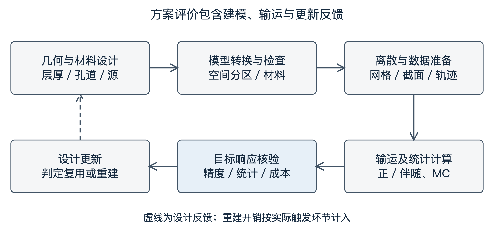
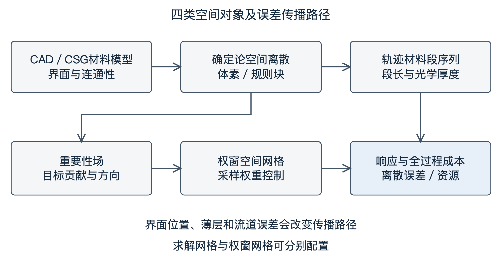
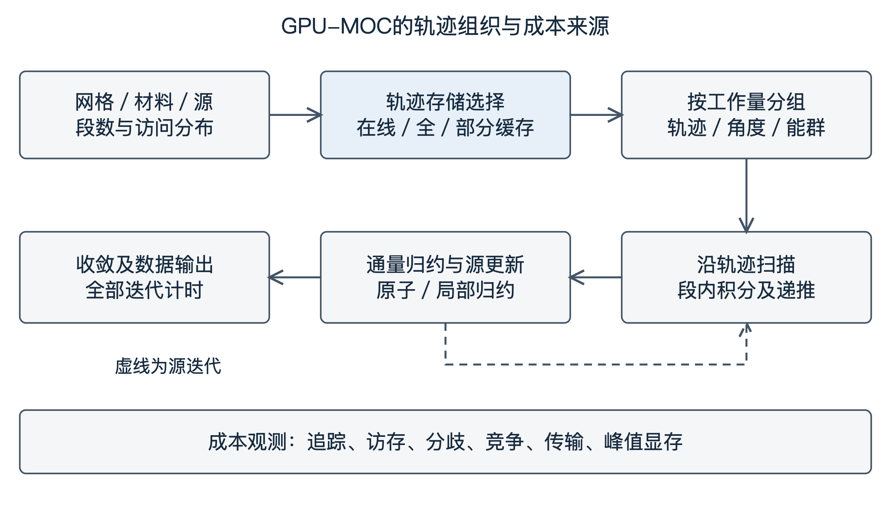
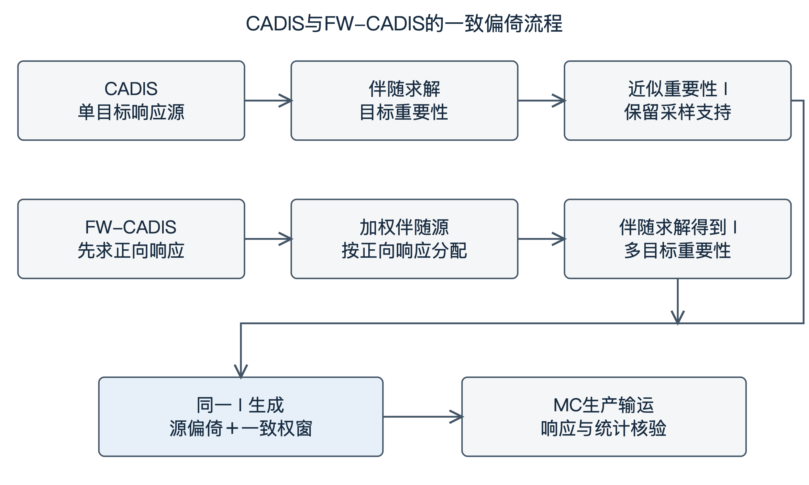
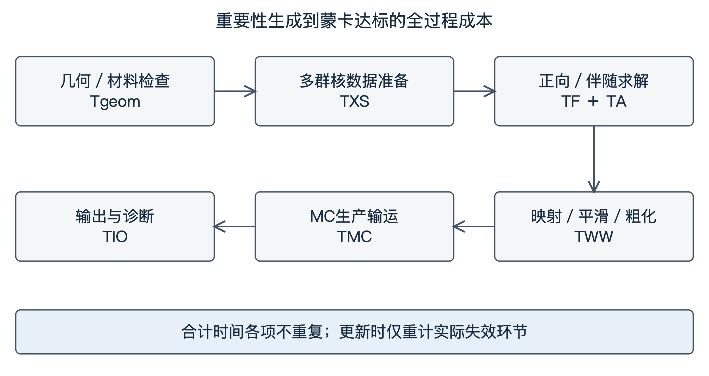
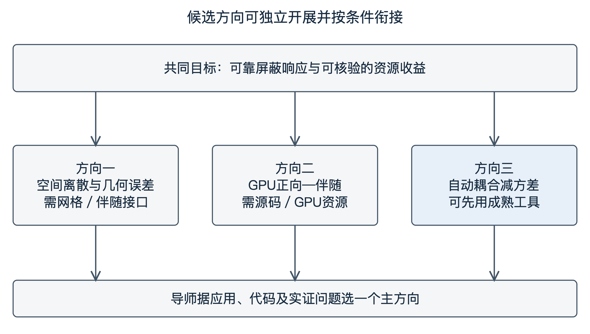

面向聚变堆屏蔽的高效中子输运与确定论—蒙特卡罗耦合减方差方法研究设想

# 第一章 研究背景与博士阶段总体研究设想

## 1.1 研究背景

### 1.1.1 核工程中子输运计算的研究意义

中子输运计算将核反应数据、源分布和几何材料信息转化为可供工程决策使用的通量、反应率与能量沉积。对于聚变装置，屏蔽设计既关系到超导磁体和结构材料的辐照环境，也影响设备布置、维护条件及人员防护。计算的价值在于回答具体方案能否满足响应约束，以及哪些结构修改值得继续考察。因此，研究数值方法时，需要把局部输运误差、目标量可靠性和方案评价成本联系起来。

### 1.1.2 聚变堆复杂几何与深穿透屏蔽计算的主要挑战

聚变装置屏蔽设计既要控制材料与结构布局，也要核验磁体核热、区域通量、反应率和剂量等响应。对于复杂非轴对称装置，局部层厚、孔道和材料组合的改变能够影响不同位置的响应。Moreno等提出ParaStell，利用参数化几何生成和输运计算评估仿星器包层、屏蔽厚度与磁体核热、氚增殖率之间的关系，展示了“几何设计—模型生成—输运响应—再次修改”的迭代流程[1]。Liew与Ku则通过重复输运分析研究CIT试验大厅的混凝土组成与屏蔽厚度选择[2]。前者体现参数化设计的工具化发展，后者说明反复求解本来就是屏蔽优化的一部分。

复杂工程几何通常需要转换为输运计算程序支持的形式，并检查几何完整性、空间分区及材料映射，避免区域遗漏、重叠和赋值错误。Tsige-Tamirat等的ITER中子学模型研究说明，自动化几何转换仍须配合模型核验[3]。深穿透还使远端响应受少量有效路径支配，孔道连通性、薄层位置和散射方向的近似可能改变这些路径。Ebiwonjumi等利用FNS的14 MeV钨、钒和铍材料实验比较中子/光子能谱、反应率、光子核热与氚产额，说明评价不能仅依赖一个标量通量[4]。车锐等基于FNS-Duct、FNS-W研究流道穿透与钨材料屏蔽，进一步提供了国内程序处理几何流道和材料问题的验证依据[5]。

### 1.1.3 确定论与蒙特卡罗输运方法的特点及互补关系

本研究设想从稳态多群固定源问题出发。角通量的输运平衡和线性目标响应分别写为

$$\boldsymbol\Omega\cdot\nabla\psi_g(\mathbf r,\boldsymbol\Omega)+\Sigma_{t,g}(\mathbf r)\psi_g(\mathbf r,\boldsymbol\Omega)=Q_g[\psi](\mathbf r,\boldsymbol\Omega)$$ {#eq-transport}

$$R=\sum_g{\int_{V_D}{w_g(\mathbf r)\phi_g(\mathbf r)\,\mathrm dV}},\qquad\phi_g=\int_{4\pi}{\psi_g\,\mathrm d\Omega}$$ {#eq-response}

其中，$g$为能群，$Σ$为宏观截面，$Q$包含外源和相关的散射、次级中子产生源项；固定源问题不以临界本征值为目标。w按目标定义选取：反应率使用相应反应截面，通量取单位权重，剂量使用能谱转换系数。核热还需与中子—光子产生和能量沉积模型一致，氚增殖率则需对产氚反应率积分并按源中子归一化。

确定论方法通过空间、角度和能量离散求解，可提供全域场和伴随信息，但需控制离散、核数据及迭代误差。蒙特卡罗方法直接抽样粒子历史，便于处理复杂连续几何和能量分布，但深穿透目标可能难以获得足够的有效计数。混合方法用近似重要性信息重新分配蒙卡样本，最终响应仍由带权粒子估计得到。两类方法的互补建立在目标和输入一致性上，并不等于把两个通量结果简单相加。

### 1.1.4 高性能计算与快速屏蔽方案评价的发展需求

一次合理可信的计算通常至少需要几何/材料转换与检查、空间角能离散及求解数据准备、全部迭代和数据传输输出，以及设计修改后的更新重算。一个GPU内核更快，并不必然缩短上述过程；空间网格更粗，也不意味着探测器响应可接受。图1将设计反馈和可能触发重建的环节纳入同一计算链。后续评价以获得合格响应的完整时间及峰值内存为成本，分别考察首次计算和多次设计更新。

{width=15.7cm}

图1 聚变屏蔽方案评价与设计更新闭环

## 1.2 国内外研究的主要发展方向

### 1.2.1 复杂几何与自适应空间离散方法

复杂几何研究同时沿直接几何追踪、非贴体材料投影和局部网格自适应推进。OpenMOC提供了可扩展的特征线输运实现，MOCkingbird进一步研究三维非结构网格上的直接特征线求解[6,7]。Baker等以探测器响应驱动各向异性网格自适应，Liu等将非匹配笛卡儿网格、多层扫描和双重加权残差发展成相互衔接的研究路线[8,9,10,11]。这些进展使“哪里需要分辨率”成为可由目标量约束的数值问题，同时留下了材料路径误差与并行执行成本如何共同评价的问题。

### 1.2.2 GPU加速确定论中子输运方法

GPU研究已从二维扫描加速推进到显存管理、多GPU负载分配和三维求解。宋佩涛的研究强调通信与扫描重叠，ANT-MOC建立存储、计算和通信模型，近年的Song、STREAM3D-GPU及NuDEAL分别采用不同的轨迹组织或空间离散缓解资源约束[12,13,14,15,16,17]。这些工作说明GPU可用性取决于数值结构与数据组织；面向聚变固定源和伴随预计算，仍需重新核验源项、边界与目标响应，而不能直接沿用临界堆芯的性能结论。

### 1.2.3 自动减方差与确定论—蒙卡耦合方法

CADIS以伴随重要性同时设计源偏倚和权窗，FW-CADIS进一步利用正向响应配置全局或多目标的采样资源[18,19]。研究重点已由实现基本耦合，转向角度重要性、网格配置、权窗存储和高性能执行。Ibrahim等的自适应FW-CADIS、NECP-MCX及OpenMC随机射线工作流构成直接比较基础[20,21,22]。本计划关注的问题是重要性信息是否足以改善最终统计效率，以及获得这些信息是否值得其前处理成本。

### 1.2.4 聚变屏蔽计算的工程应用与发展趋势

聚变应用正把参数化几何、实验基准和自动减方差连接起来。ParaStell支持设计变化，FNS/SINBAD提供材料响应与穿透实验，ITER混合计算展示了设施级剂量评价的实际需求[1,4,5,23]。相应趋势是把模型来源、核数据版本、求解条件和响应统计纳入可追溯计算流程。公开子结构和实验算例适合作为方法起点，大型装置模型则在获得合法数据和必要软件后用于适用性评价。

## 1.3 博士阶段的初步研究目标

### 1.3.1 复杂几何下的数值计算可靠性与效率

拟研究几何材料表示、局部离散与目标响应之间的关系，识别薄层、斜界面及孔道连通性中的主要误差来源。预期目标是形成有解释力的局部配置依据，在保持指定响应可靠性的条件下比较预处理、求解和存储成本。是否采用块结构、非贴体投影或已有自适应接口，将由最接近工作的不足和实际软件条件共同决定。

### 1.3.2 GPU中子输运计算方法与计算资源优化

围绕轨迹分段分布、在线生成与缓存、扫描和归约研究正向及伴随任务的资源开销，建立与实际实现相符的成本分解。评价将匹配核数据、离散精度、收敛标准和硬件预算，检验性能变化能否转化为完整预计算时间的缩短。

### 1.3.3 基于重要性信息的蒙卡高效屏蔽计算

以CADIS/FW-CADIS及纯蒙卡自动权窗为基线，研究重要性场的空间、角度和能量近似如何影响权窗质量、统计可靠性与总成本。以耦合减方差为主要方向时，可先依托成熟正向—伴随工具开展研究，再依据证据决定是否引入新的网格或GPU模块。

# 第二章 复杂几何中子输运与自适应空间离散方法

## 2.1 国内外研究现状

### 2.1.1 CAD、CSG及非贴体网格几何表示方法

CAD描述设计曲面与实体，CSG通过基本曲面和布尔运算构造输运区域，非贴体方法则在独立背景网格上投影材料。几何转换首先要保持实体拓扑、边界和材料分区的一致性。国内Chen等将MCAM的CAD几何与射线追踪用于二维MOC，采用菱形差分缓解平通量近似的空间误差[24]；Yang等的AMDOP研究笛卡儿/柱坐标网格上的体积加权混合材料映射[25]。前者改进轨迹对几何的访问方式，后者处理单元内材料表示。

### 2.1.2 规则体素与块结构网格的组织方法

规则体素可用整数索引定位材料和源区，规则块则把局部高分辨率区域组织为可批量处理的矩形数据。AMReX提供块结构多层网格管理、重排和并行基础[26]。任丽欣等的综述讨论GPU自适应笛卡儿网格构建与仿真应用，提示层级组织、平衡约束和动态更新本身也有成本[27]。

### 2.1.3 特征线法与其他确定论输运空间离散方法

MOC在给定方向上求解沿程一维输运方程，空间表示决定轨迹的材料序列、段长及源近似。OpenMOC展示C++/Python求解框架，Gaston等研究一般非结构网格上的三维长特征线，在扩大几何适应性的同时需要处理分段与跨域通信[6,7]。相比之下，$S_N$常将角度离散与差分、有限元等空间格式结合，非匹配界面需要相应的通量传递。不同方法可以共享网格管理思想，但界面公式、守恒关系及误差估计不能直接互换。

### 2.1.4 自适应网格、目标导向误差估计及局部加密研究

Baker等针对含探测器的固定源屏蔽，用正、伴随信息构造目标导向各向异性网格；Goffin等将目标泛函误差控制扩展到本征值问题[8,28]。Buchan等把浸没体材料投影与自适应网格结合，处理复杂内部结构，同时讨论材料投影、网格调整与求解成本[29]。这说明目标导向方法既要选择细化位置，也要与所用空间格式及材料处理相匹配。

国内Liu等的研究形成明确递进：2020年以多层八叉树处理非匹配笛卡儿网格及角通量矩映射；2022年采用多层金字塔数据结构、空间矩比指标与优化扫描，在所测强非均匀问题上较均匀细化节省60%—80%计算成本；2023年把DWR用于多群$S_N$固定源和临界计算，在其算例相近目标精度下节省超过70%的工作量和时间[9,10,11]。这些数字的基线是各论文的均匀网格，不构成本计划GPU-MOC的性能预期。Wilson等进一步结合DWR、h(p)自适应、等几何离散及扩散加速[30]。表1归纳其方法作用与迁移边界。

表1 复杂几何与目标导向空间离散方法比较

| 工作 | 几何与方法 | 主要进展 | 误差和成本边界 | 与候选研究关系 |
| :--- | :--- | :--- | :--- | :--- |
| Chen 2014、Yang 2024[24,25] | CAD追踪二维MOC；CAD至$S_N$映射 | 直接几何访问；体积加权材料 | 源近似与材料映射分属不同误差 | 分离几何与输运误差 |
| Baker、Goffin 2013[8,28] | 有限元、伴随目标导向 | 探测器/本征值泛函误差控制 | 残差依赖空间格式；不等于权窗效用 | 目标误差基线 |
| Buchan 2019[29] | 浸没体投影＋自适应网格 | 复杂内部结构非贴体表示 | 材料投影与重网格有成本 | 材料表示直接先例 |
| Liu 2020[9] | 八叉树非匹配笛卡儿$S_N$ | 界面角通量矩映射 | 跨界传递须匹配离散 | 层级界面处理参照 |
| Liu 2022、2023[10,11] | 多层扫描；DWR目标导向 | 全局/目标精度与成本控制 | 已有节省量仅属原论文测试 | 成熟自适应比较对象 |
| Wilson 2026[30] | IGA、DWR、h(p)、DSA | 目标适应与加速结合 | 几何/阶次/收敛相互作用 | 不把h(p)适应当新概念 |
| AMReX 2021[26] | 规则块层级框架 | 数据管理与并行基础 | 不自动提供输运守恒或伴随 | 可复用工程基础 |

来源：文献归纳。各行方法与误差对象不同，不作统一速度排名。

## 2.2 已有研究的主要进展与局限

### 2.2.1 复杂几何与材料界面表示的数值误差

几何误差可以来自曲面阶梯化、单元材料混合、薄层消失或孔道闭合；离散误差则来自给定材料模型上的源展开、角向求积、轨迹积分和迭代。这两组误差可能相互抵消，因而仅看一次响应接近参考值难以判断机制。体积相近不保证沿重要方向的光学厚度和空隙连通性相同。拟将薄层、斜界面和狭窄流道分别测试，在材料体积、弦长和目标响应三个层次追踪误差，图2给出这一因果关系。

{width=15.7cm}

图2 几何表示、空间离散与目标成本的作用关系

### 2.2.2 局部加密对目标响应精度与计算成本的影响

目标导向加密已证明，在特定空间格式和算例上可以减少达到目标精度所需的未知量[8,11]。但MOC的成本还取决于段数、跨块交点、不同轨迹工作量和通量相互作用的结果。若局部加密显著增加短段或工作分歧，未知量减少未必意味着扫描更快；若网格和轨迹需频繁重建，首次收益也未必延续到设计序列。需要在相同响应容限下联合比较网格与执行配置，并保留没有时间收益的结果。

### 2.2.3 网格精度与输运重要性场质量的区别

几何模型描述物体，确定论网格承载近似解，重要性场描述对指定响应的贡献，而权窗网格承载蒙卡的权重控制参数。它们可以使用不同分辨率。正向通量更精确，不必然使所有响应的伴随场都更有效；伴随场全局误差较小，也未必改善对罕见路径的采样。Ibrahim的确定论网格调整与NECP-MCX权窗粗化已提示，应按最终任务分别评价求解网格与权窗表示[20,31]。

## 2.3 初步研究思考

### 2.3.1 复杂屏蔽几何中哪些区域需要高分辨率表示？

高分辨率应优先保留对目标贡献显著、且几何近似容易改变其光学厚度或连通性的结构，而非仅按曲率或通量梯度分配。可设置层厚、倾角、孔道宽度及屏蔽厚度可控的几何分组，比较几何指标、正向残差与伴随加权指标标记的位置。若某指标只减少几何误差而不改善响应或采样效率，其适用性就应限于几何建模任务。

### 2.3.2 是否能够根据屏蔽响应和重要性信息指导局部网格配置？

问题在于材料映射误差和权窗效用是否需要额外指标，例如比较正向指标、DWR类指标及路径相关指标，在同样单元数或预计算预算下考察目标响应和蒙卡有效计分。应先改变一个误差来源，再研究指标组合，避免把多项参数同时优化后的收益全部归于新指标。

### 2.3.3 块结构表示是否适合确定论—蒙卡耦合的预计算需求？

块结构的优势在于规则块内访问和局部更新，潜在不足是层级定位、跨块段处理及网格映射。其适用性需要判断：在同样统计目标下，块结构是否使正/伴随与蒙卡合计时间下降。若最终权窗可以充分粗化，确定论细块的成本可能难以回收；若几何更新集中于少数块，局部重建则可能有价值。

## 2.4 可能开展的研究内容与关键技术

### 2.4.1 复杂几何的规则块表示与材料映射

拟从均匀规则网格建立可追溯材料映射，记录原始区域、材料标识、密度和网格版本，再实现局部块细化。优先检查体积覆盖、重叠、遗漏及孔道连通性，并用可解析几何的弦长交点作参考。混合材料均匀化与显式界面处理作为不同试验选择，避免把材料近似变化隐含在网格加密中。

### 2.4.2 局部加密与跨块特征线处理

轨迹穿越需要在粗细交界保持坐标、方向和材料段序列一致，避免重复段、零长段和区域遗漏。对长特征线，沿程入射—出射角通量递推应连续；若采用短特征线或有限元界面传递，则须按对应离散证明守恒。拟用反向追踪、段长总和及纯吸收解析衰减检查，再测试角通量积分是否保持区域体积权重，从而实现与验证局部加密和输运接口。

### 2.4.3 空间离散误差与响应可靠性评价

先在一致多群截面和几何条件下，分别收敛空间、角度、轨迹间距及迭代误差，再与独立参考解比较。采用绝对与相对容限组合评价微小响应，避免近零值的相对误差失真。之后改变几何表示或核数据，分析综合工程偏差。对参考蒙卡结果同时给出统计不确定度；同一近似几何上的程序间一致，主要检验输运实现，不足以证明原始CAD表示正确。

### 2.4.4 面向重要性计算的网格精度与成本分析

拟将网格细度、角度阶次和能群结构作为独立因素，在满足基本数值收敛后比较重要性场的形状、有效通道覆盖与最终权窗性能。计时包括网格建立、材料映射、截面准备、正/伴随求解和跨网格转换，记录峰值内存与数据量。筛选依据是满足同一蒙卡统计目标的合计时间；新指标若未超过DWR或成熟权窗粗化基线，则据此收缩其贡献范围。

## 2.5 可能成果、验证方法及技术风险

可能成果包括可重复的几何—离散误差分解算例、针对重要输运路径的局部配置指标，以及给定资源预算下的网格适用性判断。主要风险是几何指标与响应关联不足、DWR成本过高，以及局部加密带来的不规则执行抵消收益。验证按解析几何、受控材料与孔道、公开实验模型递进；在证据不足时保留均匀网格或成熟自适应方法作为基线，而不预设块结构一定占优。方向一是否形成博士研究主线，取决于能否解释并改进最接近工作的具体局限。

# 第三章 GPU加速确定论中子输运计算方法

## 3.1 国内外研究现状

MOC沿特征线作局部解析积分。在平源、段内截面恒定时，入射与出射角通量满足 式（3） [6]。

$$\psi_{\mathrm{out}}=\psi_{\mathrm{in}}e^{-\Sigma_tl}+\frac{Q}{\Sigma_t}(1-e^{-\Sigma_tl})$$ {#eq-moc}

其中ℓ为段长，Q为给定迭代中的角源，Σ为总截面。

单条轨迹内部存在沿程依赖，多条轨迹在给定源和相应边界迭代条件下可提供大量并行任务。宋佩涛博士论文及系列工作讨论二维并行粒度、性能模型、MPI/GPU通信掩盖、CPU/GPU负载分配及MOC-EX与CMFD，形成ALPHA研究路线[12,13]。Li等的ANT-MOC利用存储、计算、通信模型及多级负载映射实现大规模多GPU三维输运[14]。汪岸博士论文与Wang等循环轨迹分解研究进一步说明负载估计应考虑轨迹长度分布，而非只平均分配轨迹数量[32,33]。

显式保存可以减少重复几何计算，但存储全部三维段容易受显存限制；在线生成以额外追踪换取存储空间，部分缓存则在两者之间配置数据。Zhou等比较在线生成、显式轨迹和分组均衡，其在线轴向追踪利用二维轨迹和轴向挤出结构[34]。Song等在直接三维MOC中结合源近似、在线轴向追踪和批处理缓解显存需求；Dzianisau与Lee采用轴向分解、异步执行和MOC/DD[15,16]。

显存不仅用于轨迹段，还包括源项、标量/角通量、散射矩、边界数据和求解器工作区。ANT-MOC将存储、计算与通信共同建模，NuDEAL针对不同离散采用压缩角通量和方位角顺序扫描[14,17]。NVIDIA文档强调合并访存、数据复用及同步成本，warp聚合原子操作展示减少竞争的一般技术[35,36]。

正向和伴随问题共享轨迹、截面与空间结构，但伴随涉及散射转置、能群耦合方向及对应边界条件。现有研究主要给出堆芯正向或本征值求解性能；是否提供可用于CADIS的固定源伴随接口，需要按具体实现核实。NuDEAL中的MOC/HFEM、DGMOC受轴向挤出条件约束，一般多面体能力来自DFEM-$S_N$，不能把整个框架统称为任意几何三维MOC[17]。成熟减方差系统的正/伴随流程可作为数值一致性参照[37]。

## 3.2 已有研究的主要进展与局限

### 3.2.1 GPU-MOC现有算法的性能与资源要求

表2分别列出离散路线、硬件条件和相关结论。Song等的组件速度相对于单线程CPU，显存结果也绑定具体组件和源/轨迹配置；STREAM3D-GPU的22.1倍和40.5倍分别为8/16 GPU相对128核CPU的求解比较，每MPI进程显存需求由约50 GB降至4.5 GB以下[15,16]。

表2 GPU及并行MOC工作与性能比较口径

| 工作 | 离散与验证对象 | 存储及执行贡献 | 结论 |
| :--- | :--- | :--- | :--- |
| OpenMOC 2014[6] | 主要二维MOC基准 | 可扩展并行求解框架 | 不作聚变3D伴随性能证据 |
| 宋佩涛2019/2021[12,13] | 二维MOC；MOC-EX | 通信掩盖、负载分配 | 2019五节点20GPU下总体改善约8% |
| ANT-MOC 2023[14] | 直接三维、全堆芯轨迹 | 存储/计算/通信模型、多级映射 | 70.69%/89.38%为原问题强/弱扩展效率 |
| 汪岸2025、Wang2024[32,33] | 直接三维循环轨迹 | 长度分布与组合负载模型 | 不将CPU扩展结果写为GPU加速 |
| Song 2026[15] | 少群直接三维，组件/SMR | 在线轴向追踪、批处理等 | 组件最高1015.8倍；原25cm组件显式存储22129MB |
| STREAM3D-GPU 2026[16] | 三维MOC/DD，OPR-1000 | 轴向分解与异步；每进程约50GB降至4.5GB以下 | 22.1/40.5倍属该求解比较；GPU型号需全文核验 |
| NuDEAL 2026[17] | MOC/HFEM、DGMOC、DFEM-$S_N$ | 压缩角通量、顺序方位扫描 | 前两者轴向挤出；一般几何属DFEM-$S_N$ |

### 3.2.2 网格表示和轨迹分布对GPU执行效率的影响

规则块使块内索引和数据访问集中，局部细化却可能增加短段和跨块定位；复杂轨迹的段数分布会影响warp内工作分歧。图3把几何访问、存储选择、扫描和归约联系起来。在GPU-MOC计算中，不同特征线可并行完成角通量扫描，但多条轨迹对同一空间单元的通量贡献需要进行归约累积。直接原子加法能够保证并行更新的正确性，但可能因同址写入竞争而增加计算开销；线程块内局部归约可减少全局原子操作次数，同时引入额外的分组和同步成本。空间网格及轨迹组织方式会改变通量累积的竞争分布，因此归约策略也是GPU-MOC性能优化的重要环节。拟以段数分布、有效带宽、分支效率、原子竞争和峰值显存解释时间变化，再判断收益是否持续到全部迭代。

{width=15.7cm}

图3 GPU-MOC轨迹策略、扫描和归约流程

自绘示意，虚线表示源迭代；性能瓶颈由实际实现测量确定。[13,14,34,15,16]

### 3.2.3 已有求解器对固定源及伴随问题的支持情况

多数GPU-MOC工作以临界本征值、组件功率或全堆芯计算为主要验证场景；聚变屏蔽则常为高能源固定源和局部小响应。需要检查外源归一化、上散射及相关次级产生、各向异性散射与真空边界，并以固定源算例验证。

## 3.3 初步研究思考

### 3.3.1 GPU并行方法能否降低复杂三维确定论预计算成本？

比较从输入更新到可用正向/伴随场的完整时间，并区分源项更新、材料更新和几何更新。GPU收益可能随计算规模、迭代次数与数据驻留程度变化。假设是特定任务组织在一定规模和更新类型下缩短预计算，而非GPU在所有条件下更快。测量以优化多核CPU与可访问GPU实现为基础，并记录编译、精度与计时边界。

### 3.3.2 非均匀网格与GPU轨迹执行之间存在怎样的成本关系？

拟把网格与轨迹策略作为联合变量，比较均匀细网格和局部网格分别配合在线、全缓存及部分缓存的最合适配置。调参预算保持对等，正式算例与调参算例分开。随后固定代表配置，通过分组与归约消融识别交互作用。若块定位和工作不均衡抵消段数减少，应报告无时间收益的条件，而非将未知量减少解释为加速。

### 3.3.3 如何在伴随求解精度与预计算成本之间取得平衡？

伴随精度首先应满足正—伴随一致性和目标相关收敛检验，再考察更细离散是否有足够的蒙卡收益抵偿成本。拟以相同探测器和物理源建立一组由粗到细的重要性场，固定权窗生成规则，测量预计算与蒙卡时间；另行改变映射和权窗参数，定位收益来自何处。若伴随细化只改善确定论误差而不改善统计任务，适宜停在较低成本配置。

## 3.4 可能开展的研究内容与关键技术

### 3.4.1 GPU-MOC轨迹与数据结构设计

以可修改MOC实现为前提，整理源区、材料、能群和轨迹段的访问关系，建立在线生成与缓存共享的几何核。按实际段数或估计工作量分组，比较轨迹—能群任务组织和不同数据布局。部分缓存按资源预算配置，其容量由预实验决定。先保证各路径生成相同材料序列，再比较数据量和时间，避免把数值改变混入执行优化。

### 3.4.2 并行扫描、归约与显存管理

扫描保持单条轨迹沿程依赖，源区通量由轨迹积分和求积权重归约。拟比较直接原子累加与线程块内局部归约，再检查临界区竞争、浮点累加次序和工作区开销。峰值显存通过运行时测量核实，并包含通信及求解器临时缓冲。异步传输或重叠执行须用同步完成后的计时验证，同时保留独立分项剖析，以免把等待时间移出测量范围。

### 3.4.3 正向—伴随计算能力及数值正确性验证

先验证纯吸收、真空极限、均匀介质和跨界段，再做多群散射与伴随测试。离散层面以体积、角权重构成加权内积，检查离散算子与其伴随的对偶关系，以及正向响应与伴随源响应的一致性；反向追踪本身不足以完成该检验。CPU/GPU结果比较须同时考察守恒、局部响应和精度敏感性。通过后再把伴随场用于权窗，避免以蒙卡减方差有效间接代替伴随正确性。

### 3.4.4 GPU计算性能与资源适用性分析

记录前处理、扫描、归约、源更新、迭代、传输及输出时间，按实际发生次数构成方案周期。首次运行、数据可复用更新和需重建更新分别报告；硬件间比较注明核数/GPU数、内存、精度和收敛标准。预期成果是可由段数分布、资源预算和更新类型解释的执行选择依据。若代码接口或GPU资源无法落实，则应调整候选方向；现有Python/C++与输运建模经验提供学习基础，申请人仍需系统补足GPU编程和MOC实现能力。

# 第四章 确定论—蒙特卡罗耦合减方差方法

## 4.1 国内外研究现状

厚屏蔽和狭窄孔道使远端探测器响应由少量有效输运历史主导。直接蒙特卡罗（MC）抽样能够描述复杂几何与碰撞过程，但大量粒子在到达目标前即被吸收或离开系统，低响应区域因此长期缺少计数。源偏倚改变出生粒子的采样分布，分裂与俄罗斯轮盘调节输运中的粒子数量；二者通过相应权重修正保持响应估计的期望。权窗规定各空间—能量区间适宜的粒子权重范围，其有效性取决于能否把计算投入引向对目标有贡献的路径。

Wagner与Haghighat将离散纵标伴随函数用于MCNP源偏倚和一致权窗，建立CADIS的经典实现；Wagner等进一步发展面向响应分布的FW-CADIS。Munk与Slaybaugh的综述表明，自动减方差已经形成确定论驱动、MC迭代驱动及角度相关改进等多条路线[18,19,38]。

令稳态线性固定源输运算子为$\mathcal L$，物理源为$q$，目标响应函数为$q^\dagger$，以空间、角度和能量相空间内积表示正向与伴随关系：

$$\mathcal L\psi=q,\qquad\mathcal L^\dagger\psi^\dagger=q^\dagger,\qquad R=\langle q^\dagger,\psi\rangle=\langle q,\psi^\dagger\rangle.$$ {#eq-adjoint}

 式（4） 要求边界条件与内积配对一致；伴随角通量表示粒子状态对指定响应的贡献。CADIS以其近似作为重要性。为区分物理源强与抽样概率，令$p(x)$为归一化源概率密度，$I(x)>0$为在源支持集上的近似重要性，则

$$C=\int{p(x)I(x)\,\mathrm dx},\qquad\widehat p(x)=\frac{p(x)I(x)}{C},\qquad w_0(x)=\frac{p(x)}{\widehat p(x)}=\frac{C}{I(x)}.$$ {#eq-cadis}

这里$x$包含被偏倚的源变量，$C$是抽样归一化量。若采用近似重要性，$C$并非精确物理响应。 式（5） 同时说明源偏倚与目标权重应来自同一重要性；输运权窗目标通常与$I^{-1}$成比例。对各向同性源的空间—能量偏倚，可采用角平均伴随重要性；若以角积分标量伴随通量替代，常数归一化需相应一致。近似场只用于偏倚时，其误差主要影响方差和成本；支持集缺失、错误权重或输运截断则可能改变估计期望[18,38]。

单目标CADIS将探测器响应函数作为伴随源。面对多个探测器或大范围网格响应，FW-CADIS先计算正向通量或响应，再提高预计低响应区域的伴随源权重，以争取更均匀的相对统计精度。对具有可比较归一化约定的多个目标，

$$q^\dagger_{\mathrm{FW}}=\sum_{i=1}^{N_D}\frac{\beta_i}{\widetilde R_i}q_i^\dagger,\qquad\widetilde R_i>0.$$ {#eq-fw}

其中$R_i$为正向近似响应，$\beta_i$表达目标优先级及单位归一化。连续网格通量、积分剂量和多个局部响应各有相应伴随源定义。FW-CADIS优化的是采样投入的分配，实际各目标RSD仍受几何、能谱和权窗执行影响[19]。图4对照了CADIS与FW-CADIS的求解顺序以及一致偏倚关系。

{width=15.7cm}

图4 CADIS与FW-CADIS的双路线及一致偏倚

强方向性流道中，同一位置、同一能量而方向不同的粒子，对探测器贡献可能相差很大。Munk等的CADIS-Ω利用正、伴随角信息构造角度加权的替代标量重要性，在Denovo/ADVANTG混凝土迷宫问题中验证了初步效果[39]。Zhao等提出局部角度自适应LAA-CADIS，进一步针对复杂孔道的角度依赖改进权窗生成[40]。

MS-CADIS则处理另一类问题：停堆剂量依次经历中子输运、活化和衰变光子输运。Ibrahim等以最终停堆剂量反推中子重要性，使前一步抽样服务于最终响应[41]。

### 4.1.2 自适应网格、权窗粗化及自动化耦合框架

Ibrahim等将CADIS/FW-CADIS与CAD蒙卡用于ITER核热、剂量和通量分析，随后结合材料宏观化、确定论网格细化和权窗网格粗化[20,23]。2014年研究的两次MCNP计算均为10天、权窗规模相近，非零计分网格比例由79.3%提高到97.8%；23.3%是非零计分元素数的相对增加，并非端到端加速或满足统计阈值的覆盖增长[20]。

国内郑华庆等整合自动网格生成和权窗平滑，NECP-MCX嵌入NECP-Hydra正向—伴随求解，Zheng等又以贡献理论指导笛卡儿和嵌套权窗网格粗化[21,31,42]。MAVRIC提供Denovo—CADIS/FW-CADIS—Monaco自动流程，OpenMC提供MAGIC及内置random-ray生成FW-CADIS权窗的流程[22,37]。表3比较方法目标与信息来源。

表3 自动减方差方法的信息来源与适用目标

| 方法 | 重要性信息 | 适合的目标 | 主要成本/限制 |
| :--- | :--- | :--- | :--- |
| CADIS[18] | 指定响应的伴随场 | 单个或明确局部响应 | 伴随与源偏倚/权窗须一致 |
| FW-CADIS[19] | 正向加权的伴随场 | 多探测器、区域或全局 | 增加正向求解；零响应保护 |
| MS-CADIS[41] | 跨中子—活化—光子步骤的重要性 | 停堆剂量 | 需要活化与光子数据及接口 |
| CADIS-Ω[39] | 正、伴随角信息形成替代标量 | 强方向性穿透 | 角通量计算与存储成本 |
| LAA-CADIS[40] | 局部角度自适应信息 | 方向性屏蔽 | 比较需有对应可运行实现 |
| MAGIC[22] | 迭代MC通量估计 | 自动全局权窗 | 低计数区探索与迭代预算 |
| random-ray FW-CADIS[22,43] | 多群随机射线正/伴随 | 局部与全局响应 | 仍需MGXS、源区划分及射线收敛 |

Raffuzzi等在SCONE随机射线求解器中实现CADIS/FW-CADIS，并在整体屏蔽和源—探测器两类问题中与直接MC、MAGIC比较。其测试中，提高截面或随机射线解的保真度未改善最终减方差，提示权窗任务有效性与通量逼近精度并不一致；两个算例没有显著流束通道，结论尚不能推广到聚变狭窄孔道[43]。

Zhang等在cosRMC中将八叉树自适应网格、邻接关系与响应矩阵权窗相结合，并优化并行内存配置，在CFETR扇区开展应用[44]。Evans等研究Shift的CPU历史型和GPU事件型权窗输运，表明现代架构上的混合减方差执行同样已有实证[45]。

表4 自适应耦合与权窗优化的直接先例及候选增量

| 直接先例 | 已解决的问题 | 本计划需要比较的对象 | 尚可检验的具体问题 |
| :--- | :--- | :--- | :--- |
| Ibrahim 2014[20] | 材料宏观化、确定论细化、权窗粗化 | 求解网格与权窗网格解耦 | 路径误差与更新成本的作用 |
| 郑华庆等2016[42] | 自动确定论网格与权窗平滑 | 平滑、映射与接口基线 | 跃变控制是否牺牲重要通道 |
| NECP-MCX/改进VENUS-3[21,31] | 正/伴随自动耦合、贡献粗化 | 贡献导向粗化 | 物理路径保护与内存预算 |
| cosRMC 2024[44] | 八叉树、自适应响应矩阵权窗、CFETR应用 | 材料驱动层级权窗 | 与目标/几何指标的差异 |
| LAA-CADIS 2025[40] | 局部角度重要性改进 | 强方向性基线 | 空间和角度误差分别贡献多少 |
| OpenMC、Raffuzzi[22,43] | random-ray FW-CADIS及MAGIC比较 | 开放重要性生成流程 | 流道中有效精度与前处理成本 |
| Shift 2026[45] | CPU/GPU权窗输运 | 高性能MC执行 | 分裂队列及传输何时主导 |

## 4.2 已有研究的主要进展与局限

伴随近似误差改变粒子投入在相空间中的分布，而确定论目标响应误差衡量某个积分量的偏差。MAVRIC手册强调，权窗需要稳健、为正且形状合理的通量场，而不必追求高精度确定论解[37]，局部相对误差也可能受任意归一化影响。

材料均匀化可能保留体积分数却抹去低密度通道；角向求积不足又可能错估通道内的粒子传播。前者主要涉及几何与光学路径，后者涉及方向分辨率。CADIS-Ω和LAA-CADIS说明方向性已有专门处理[39,40]。可以通过直通与折弯孔道分别改变界面分辨率和角向精度，判断重要性失真来源，再考察其对粒子权重尾部及目标RSD的作用。

空间和能群划分增加会扩大权窗数据量，并增加查询、跨界检测与分裂开销。粒子分裂产生的子历史共享祖先，不能作为相互独立的原始历史统计。权窗跃变还可能造成少数历史持续很久，使并行进程负载失衡。Ibrahim、Zheng及cosRMC研究分别从网格解耦、贡献粗化和局部层级结构减轻这些负担[20,31,44]。

传统MC效率指标可写为

$$\mathrm{FOM}_{\mathrm{MC}}=\frac{1}{\mathrm{RSD}^{2}T_{\mathrm{MC}}},\qquad T_{\mathrm{all}}=T_{\mathrm{geom}}+T_{\mathrm{XS}}+T_{\mathrm{F}}+T_{\mathrm{A}}+T_{\mathrm{WW}}+T_{\mathrm{MC}}+T_{\mathrm{IO}}.$$ {#eq-cost}

式（7） 分别表示MC运行效率与互不重复的全流程时间分项，正向项对不需要它的流程取零。图5给出计时边界。Raffuzzi研究对部分FOM未计较短的权窗建立时间[43]。几何或源项更新时，还应按实际发生的截面重制、求解与权窗失效统计累计耗时。

{width=15.7cm}

图5 重要性预计算、权窗与蒙卡运行的计时边界

全局平均相对方差可能掩盖少数重要探测区的未收敛结果。零计分网格也不具有可解释的零RSD。拟同时记录非零计分覆盖、预设目标集合中的统计达标比例、关键探测器误差及独立重复分布[20]。

## 4.3 从文献调研中形成的初步思考

### 4.3.1 更精细的确定论解是否必然带来更好的减方差效果？

Raffuzzi结果提供了否定其必然性的具体证据，但尚未给出适用于流道问题的选择规律[43]。值得检验的是：当细化改善次要区域而主要贡献路径已经正确时，额外代价是否超过MC收益；反之，若粗网格错误连通孔道，局部细化能否显著改变采样投入。两种机制应在受控算例中区分。

### 4.3.2 重要性场的哪些误差对最终蒙卡效率最敏感？

我的初步判断是，贡献通道遗漏、局部对数梯度失真和权窗跨界跃变可能比远离目标的均匀误差更关键。可在固定源和响应下，分别扰动这些结构，观察RSD、有效计分覆盖、最长历史和权重尾部变化。该判断是待检验假设，不预设所有场景存在同一个最优指标。

### 4.3.3 能否根据目标响应和重要性结构优化确定论预计算网格？

目标导向离散、FW-CADIS网格适应与响应矩阵自适应权窗均已有先例[20,31,44]。可能的新问题是几何表示误差与伴随传播共同作用时，哪些局部细化真正值得投入。可将响应敏感区域与主要贡献路径作为候选指标，并与材料驱动、通量梯度驱动方案比较，而非直接把“重要性导向”当作创新。

### 4.3.4 能否通过高效确定论求解缩短自动权窗生成时间？

当正—伴随预计算占总成本较大比例时，GPU执行有改善空间；若该部分很小，即使求解明显加快，总时间也可能几乎不变。拟先建立分项计时和资源画像，再决定是否引入第三章的GPU路线。显存不足导致的分批、传输和权窗转换成本应共同纳入评价。

### 4.3.5 在什么条件下，耦合减方差不如其他自动权窗方法划算？

MAGIC免去额外确定论求解，但需要逐次MC探索低计数区域；FW-CADIS增加MGXS和正—伴随配置，却可能更早获得远端重要性[22]。两者取舍可能随屏蔽强度、目标数量和设计复用次数改变。拟以同等统计目标的实际完成时间比较，允许出现不占优或无法可靠判定的范围。

## 4.4 可能开展的研究内容

### 4.4.1 基于成熟工具的CADIS/FW-CADIS参考流程建立

首先在具备稳定正—伴随能力的工具中复现单探测器CADIS和多目标FW-CADIS，核对源、响应单位和权窗归一化。OpenMC随机射线与MAGIC可组成开放参考路线，MAVRIC等作为有授权时的成熟实现比较[37,22]。输入、版本及生成权窗的参数均与生产MC计算分开归档。

### 4.4.2 不同确定论离散精度下的重要性场与权窗评价

先固定几何材料、能群及材料/均匀化约定，分别改变空间、角向与源区离散；仅在材料区域及群常数适用条件不变时复用MGXS；再固定求解配置研究MGXS影响。对每组记录重要性结构、权窗内存、预处理和MC达标时间。单因素结果用于解释误差来源，必要时再检查可辨识的交互作用，避免同时改变多项设置后只报告一个加速比。

### 4.4.3 复杂几何下的自适应重要性表示与权窗映射

求解网格与权窗网格承担不同任务，拟允许二者独立配置。映射时保留材料界面、能群边界和响应定义的一致性，检查权窗查询在细小通道中的覆盖。粗化或平滑可能降低存储，却会改变梯度及分裂行为；应与Ibrahim、NECP-MCX和cosRMC对应处理逐项比较[20,31,44]。

### 4.4.4 显存与计算成本约束下的自动减方差参数优化

将求解精度、权窗分辨率及平滑强度视为候选参数，以响应可靠性和资源上限为约束，比较总时间。参数选择使用调试算例，正式评价使用独立几何或更新序列；调参成本单列并在实际设计流程中计入。GPU上的优化还需记录分裂粒子队列与权窗数据传输开销，避免把MC核吞吐直接作为流程收益[45]。

### 4.4.5 耦合减方差全流程效率与适用范围分析

分别评价首次建立、几何不变的源更新、材料变化与流道位置变化。分析哪些数据能够复用，哪些必须重建，并实测复用后权窗的统计表现。最终形成按响应类型、几何方向性及资源条件组织的适用性结论。若某方法只提高MC FOM却增加完整达标时间，应如实保留这一结果。

## 4.5 关键技术与验证方法

### 4.5.1 确定论正向—伴随输运计算

伴随实现需转置能群耦合与离散传播关系，并匹配边界处理。对实数离散矩阵$A$及由正体积、正角权等组成的对称正定权矩阵$W$，应检查

$$A^\dagger=W^{-1}A^\mathsf{T}W,\qquad\langle Au,v\rangle_W=\langle u,A^\dagger v\rangle_W.$$ {#eq-duality}

 式（8） 用于代码级对偶检验，随后用响应恒等式检查真实源—探测器问题。翻转特征线方向只是伴随构造的一部分。若使用现成工具，则通过其文档、接口及正—伴随互易测试确认能力，不由GPU正向支持推断伴随已具备。

### 4.5.2 多群核数据和几何材料映射

正—伴随预计算应使用一致的能群边界、散射矩和材料编号；聚变高能源问题还需明确各向异性与次级中子产生的处理。连续能MC与多群预计算之间的截面近似影响重要性质量，生产响应仍在选定物理模型上统计。分开检查CAD到求解几何、求解区到权窗网格两次映射，避免以体积守恒代替通道拓扑正确。

### 4.5.3 权窗生成、平滑、粗化及蒙卡接口

接口应保存网格坐标、能群边界、上下限约定和源偏倚归一化。对零或极小重要性设置保持采样支持的保护，并检查分裂和轮盘的期望权重守恒。OpenMC当前FW-CADIS流程要求权窗网格与随机射线源区划分满足相容条件，且仍需MGXS准备[22]。这些实现约束应进入复现记录，平滑与粗化也需逐项验证。

### 4.5.4 局部响应与全局响应的统计性能评价

局部目标比较均值与参考值、RSD、独立重复置信区间和达标时间；全局目标另报预定义区域覆盖及最困难关键区域。RSD衡量随机误差，不包含核数据和几何系统偏差。权窗与参数在生产计分前冻结，达标时间采用预先规定的停止与稳定性规则，并以独立完整重复核查；分裂子历史按其原始源历史归组。检查极端权重、零计分和批次漂移；误差条较小而不同重复不一致时，应先诊断统计稳定性。

### 4.5.5 与CADIS、FW-CADIS及纯蒙卡权窗方法的对照验证

同一问题集至少包含直接MC、适合单目标的CADIS、多目标FW-CADIS和MAGIC；方向性改进有可运行实现时再纳入。统一物理源、截面数据、响应集合与计算预算，分别报告固定时间表现和达标时间。实验基准用于物理验证，解析或制造解用于算法核验；测试集中的失败和无收益结果均进入适用范围分析。

## 4.6 可能形成的成果与需要进一步论证的问题

本方向可能形成的成果是：重要性场几何—角度—能量误差与MC统计表现之间的可复现实证关系；具有明确适用范围的预算约束网格或权窗配置方法；能够核验设计更新复用收益的完整计算流程。创新成立的前提，是相较Ibrahim自适应FW-CADIS、NECP-MCX贡献粗化、cosRMC响应矩阵网格、LAA-CADIS及随机射线基线具有可解释的改进[20,31,44,40,43]。

拟优先检验复杂流道中主要贡献路径的表示与权窗有效性，再依据可访问代码决定增量落点。导师需要进一步确认目标响应、软件许可和接口、是否纳入中子—光子耦合及可用硬件。本方向可以从成熟正—伴随工具独立开展；新增GPU-MOC只在其预计算成本占比和接口条件支持时作为加速选择。

# 第五章 面向聚变堆屏蔽的高效中子输运及耦合应用

## 5.1 国内外研究现状

聚变屏蔽评价涵盖磁体及结构核热、中子/光子能谱、反应率、剂量和增殖材料功能。不同目标对应不同能量权重和空间积分，某一目标收敛不意味着其他目标可靠。ParaStell以参数化结构展示磁体核热与氚增殖等响应的设计联系，FNS材料实验则提供能谱、光子核热和产氚反应的比较依据[1,4]。需要选择一种明确的局部响应及一组区域通量，建立可解释的误差和效率评价；核热或剂量扩展需明确中子—光子及响应数据。

SINBAD由NEA与RSICC共同维护，收录反应堆、聚变及加速器屏蔽实验；新版通过NEA GitLab管理，完整数据获取有相应许可条件[46]。Ebiwonjumi等使用OpenMC分析FNS钨、钒、铍实验，比较多种响应，部分能区仍存在计算—实验差异；车锐等用cosRMC与MCNP及FNS-Duct/FNS-W实验结果比较[4,5]。

ITER研究将CAD转换与确定论—蒙卡混合方法结合，覆盖核热、剂量与通量评价[3,23]。CFETR环向场线圈核响应研究以McCad生成输运模型，采用MAGIC全局减方差与密度降低相结合的方法，体现大型装置复杂几何与远端小响应的计算需求[47]。cosRMC多层网格研究又在CFETR扇区测试自适应权窗[44]。

Ibrahim等将混合方法用于ITER设施级剂量图，通过分别调整确定论和权窗网格改善非零计分覆盖；MS-CADIS进一步服务于最终停堆剂量[20,41]。国内NECP-MCX、自动网格平滑及cosRMC自适应方法说明，混合流程与纯蒙卡自动权窗都具备工程应用基础[42,21,44]。本计划的对照因而应包含真实可运行的成熟方法，以复杂孔道、资源和更新条件下的具体不足为研究起点。

参数化设计会重复改变层厚、材料、孔道或源分布。ParaStell的几何—输运迭代与CIT重复计算说明，方法收益需要放到方案序列中理解[1,2]。几何不变时轨迹可能复用，材料变化可能保留几何追踪但使截面与重要性失效，孔道移动则可能同时改变路径与权窗。需要分别记录这些更新，比较每次响应可用时间和固定序列累计时间，避免用首次求解结果代替工程迭代效率。

## 5.2 从已有研究中形成的认识

### 5.2.1 复杂通道与局部深穿透区域的计算困难

直通通道强调方向分辨，折弯孔道增加壁面散射与多次碰撞，厚实体屏蔽则突出强衰减和能谱变化。FNS-Duct与钨材料实验分别为通道和体屏蔽提供比较对象[5]。因此拟将孔道宽度、弯折和屏蔽厚度作为可控特征，观察误差与成本如何变化。随机射线体屏蔽中的良好表现，仍需在具有显著方向性的通道上独立评价[43]。

### 5.2.2 全局通量优化与局部探测器响应优化的区别

单探测器CADIS可把资源集中于特定位置和响应函数；FW-CADIS需在多个目标之间分配采样投入[19]。全域平均指标可能掩盖磁体附近或维护通道中的关键低响应区，局部最优权窗也可能牺牲全局覆盖。拟预先定义关键探测器、区域集合和能区，分别给出局部误差、统计达标覆盖及未达标区域，使方法选择与工程目标一致。

### 5.2.3 核数据、几何近似和数值误差对屏蔽结果的影响

需要区分核数据及响应系数、源能谱、几何材料近似、确定论离散和MC随机误差。FNS工作中的不同能区偏差说明，即使统计误差较小，物理预测仍受模型和核数据影响[4]。拟先在匹配多群输入上隔离数值误差，再用连续能或实验评价综合偏差。蒙卡权窗若保持抽样支持和权重正确，其近似主要影响效率；若最终蒙卡几何也被替换，则相应几何误差属于响应模型本身。

### 5.2.4 自动减方差方法在实际工程流程中的收益与代价

自动减方差减少人工试探，也可能引入MGXS、正/伴随求解、映射和权窗存储成本。CFETR的MAGIC组合路线与自适应网格路线提示，具体工程问题未必由单一方法占优[47,44]。需要同时报告运行预算下的响应统计表现、获得指定精度的完整时间，以及内存峰值和失败历史。工程收益由全部环节共同决定，不能由FOM_MC或某个加速内核直接推出。

## 5.3 初步研究思考

### 5.3.1 哪些聚变屏蔽问题最适合使用CADIS或FW-CADIS？

可检验的选择依据是目标数量、贡献路径结构及前处理占比。少数局部探测器适合以CADIS为起点，大范围响应适合以FW-CADIS为起点；强方向性通道再比较角度改进。对于容易直接获得计数、模型小或仅运行一次的问题，自动前处理可能难以回收成本。拟在同一算例族中逐步改变这些条件，形成具有实测范围的选择结论。

### 5.3.2 在工程几何更新后，哪些计算数据可以复用？

复用需分别核对几何、材料、源和响应的依赖。改变源分布但保持输运算子与目标时，单目标伴随解在数学上仍对应同一响应，但源偏倚必须重新归一化；FW-CADIS的加权伴随源还依赖正向场，可能需要更新。改变材料会改变输运算子，移动孔道则改变路径。旧权窗可作为候选初值或对照，其效率与支持覆盖仍应在新模型上检验。

### 5.3.3 是否能够根据屏蔽响应需求选择不同的求解或减方差策略？

拟建立以响应可靠性为约束的策略比较：给定目标集合和硬件，比较直接MC、MAGIC、成熟混合方法及候选改进的达标时间。先用有限的受控算例辨认主要成本，再以未参与配置选择的几何测试适用性。结论应允许某种策略没有占优区域或只在特定更新模式下有效；数值选择范围随软件和硬件变化需要重新标定。

## 5.4 可能开展的研究内容

### 5.4.1 典型屏蔽几何与响应算例建立

拟从解析材料段、均匀/多层屏蔽、直通/折弯孔道推进至聚变子结构和可获取实验输入。表5列明验证层级、响应、用途与基线。每个算例保存几何、密度、核数据、源及探测器定义，分别指定用于算法核验、物理验证或工程效率评价的角色。FNS和CFETR只提供来源依据，实际算例以获得可审计输入和合法使用条件为准。

表5 聚变屏蔽研究的拟用验证层级与响应指标

| 层级与算例族 | 响应及检查量 | 验证目的 | 参考依据/条件 |
| :--- | :--- | :--- | :--- |
| 解析段、真空/纯吸收 | 出射角通量、段长与泄漏 | 轨迹和输运实现核验 | MOC段积分[6]；本计划自建 |
| 薄层、斜界面、多层材料 | 弦长、反应率、区域通量 | 分离材料映射与离散误差 | CAD/MOC与材料映射[24,25] |
| 厚实体屏蔽 | 深度能谱、局部计分及RSD | 衰减与重要性效用 | random-ray屏蔽研究[43] |
| 直通/折弯孔道 | 局部响应、角向敏感性、极端权重 | 路径及方向性失真 | FNS-Duct、角度CADIS[5,39] |
| FNS钨/钒/铍 | 中子/光子谱、反应率、核热、产氚 | 模型与实验确认 | FNS研究及合法SINBAD输入[4,46] |
| 聚变子结构/扇区 | 磁体区域通量或核热、区域覆盖 | 完整流程与更新适用性 | ITER、CFETR先例[23,44,47] |

来源：真实文献支持的拟议测试设计，未声称已经完成计算。实验一致性还受核数据、源和测量不确定度影响。

### 5.4.2 局部深穿透及全局通量计算验证

局部测试先核查解析衰减、泄漏和反应率，再在厚屏蔽与孔道中比较参考均值及置信区间。全局测试预先规定目标网格/能区，分别报告非零覆盖与统计达标覆盖。制造解或解析解主要检验实现，实验基准检验模型预测，程序间一致性提供交叉证据。三类证据共同使用，避免由某一程序的既有验证结果推断新GPU归约或网格接口已正确。

### 5.4.3 重要性场与权窗适用性分析

在固定物理模型上分别改变空间、角度、能群和权窗映射，分析贡献通道、权重分布、最长历史和目标收敛。对局部高梯度或错误连通区域作针对性消融，判断细化、角向改进或平滑分别解决什么问题。与已有网格粗化、自适应权窗和随机射线方法比较后，再决定算法增量；最终保留失败条件和不确定区间。

### 5.4.4 多次方案更新下的计算效率比较

设计源更新、层厚/材料更新和孔道更新三类序列，对每种方法记录实际重建、复用核验和生产计算开销。首次数据准备、离线调参和每次更新分开计时，再按真实发生次数汇总。采用配对场景和独立完整重复评价时间差及统计可靠性，避免累加各分项中位数冒充实测累计时间。该研究可检验某种首次计算较贵的方案是否因后续复用而获得整体收益。

6.候选方案

{width=15.7cm}

图6 三个候选方向的独立起点与选择关系

[11,14,20,31,43,44]

表6 三个候选方向的创新前提与实施条件

| 维度 | 方向一 空间离散 | 方向二 GPU正—伴随 | 方向三 自动耦合减方差 |
| :--- | :--- | :--- | :--- |
| 核心问题 | 几何/路径误差与网格预算 | 网格—轨迹—执行联合成本 | 重要性效用与全流程成本 |
| 最近先例 | Liu、Ibrahim、cosRMC[11,20,44] | Zhou、ANT-MOC、STREAM3D[14,16,34] | Ibrahim、NECP-MCX、Raffuzzi[20,31,43] |
| 创新前提 | 新指标解释并改善现有指标不足 | 存在现有策略未解决的实测瓶颈 | 超过成熟权窗配置的可归因增量 |
| 资源依赖 | 可改网格、材料及伴随接口 | MOC源码、GPU与分析权限 | 正/伴随工具、MGXS与MC接口 |
| 实证门槛 | 等预算响应/MC达标成本比较 | 伴随正确＋等精度完整计时 | 统计可靠＋全过程时间占优范围 |
| 主要风险 | 指标成本超过收益 | 开发量与显存约束 | 前处理不回收、长历史 |
| 独立起点 | 成熟求解器网格接口 | 真实代码性能剖析 | 直接MC/MAGIC/FW-CADIS复现 |

来源：文献与本计划综合分析。三列是候选选择，不构成必须依次完成的任务链。

## 6.2 候选方向一：复杂几何与重要性导向空间离散

### 6.2.1 研究目标与核心问题

目标是在可控预计算预算下保留对屏蔽响应和权窗有效的几何信息。核心问题是：薄层和孔道的表示误差，能否通过响应或重要性相关指标被识别，并指导比单纯材料细化或通量梯度更有效的局部配置？观测量包括目标响应偏差、贡献路径覆盖、预计算成本、权窗内存和MC达标时间。只有在最终任务中改善这些量的合理组合，指标才具有研究价值。

### 6.2.2 与已有自适应输运工作的区别

最接近工作包括Liu的DWR目标导向$S_N$、自适应FW-CADIS及cosRMC材料驱动多层网格[11,20,44]。Liu主要控制离散目标误差，Ibrahim已调整确定论与权窗网格，cosRMC已把局部层级网格用于响应矩阵减方差。本方向拟增加的内容，是分离几何/材料路径误差与给定模型上的离散误差，检验其对权窗任务的不同影响，并在相同预算下比较局部配置。若研究只是把已有细化规则移到新模型，其贡献将限于实现和应用。

### 6.2.3 初步研究路线及创新性假设

先建立薄层、斜界面、直/弯孔道几何族，分离材料映射与空间离散；继而复现一种成熟目标导向或材料驱动指标，作为基线。候选假设是：几何连通性或光学路径误差在部分流道问题中比全域通量误差更能预测权窗失效，加入相应信息可在有限预算下改善MC效率。通过逐项扰动、等预算比较和独立几何测试证伪该判断，再决定指标是否值得发展为自适应算法。

### 6.2.4 预期成果、条件与风险

预期交付是误差—响应/统计关系、可复现算例和具有明确适用条件的局部配置方法。依赖可修改网格、材料映射和伴随接口；现有块结构框架可提供基础，但局部加密尚需实现。风险在于指标成本过高或已有DWR/粗化方法已足够有效。若独立测试没有改进，应收缩到可解释的失效机理或误差评价结果，而不以局部加密功能本身作为主要创新。

## 6.3 候选方向二：GPU确定论正向—伴随输运方法

### 6.3.1 研究目标与核心问题

目标是在相同响应可靠性和显存预算下缩短固定源正向—伴随预计算。核心问题是：段数分布、空间块结构和轨迹存储怎样与分组、扫描、归约发生交互，何时某一执行组合能够减少完整时间？伴随正确性作为方法基础，性能作为独立评价对象。研究不以单次内核速度或相对单线程CPU的大倍率作为最终目标。

### 6.3.2 与已有GPU-MOC工作的区别

最接近工作取Zhou的在线/显式轨迹、ANT-MOC的多级负载模型及STREAM3D-GPU的轴向分解[34,14,16]。它们已覆盖存储取舍、负载与异步执行。本方向拟检验复杂固定源/伴随任务中空间表示与执行策略的联合成本，并解释更新时缓存失效的影响。与这些工作的区别必须建立在不同任务约束和实测机制上；若软件只支持相同堆芯问题和相同优化，便不足以支持独立研究增量。

### 6.3.3 初步研究路线及创新性假设

先取得可修改求解器，完成多群固定源、GPU数值一致性和离散伴随验证，再剖析时间与显存。联合比较均匀/局部网格、在线/缓存策略和负载组织，用固定配置消融解释成本。候选假设是：由段数分布和更新频率共同约束的配置选择，比仅按显存容量或轨迹数量选择更能预测完整预计算收益。正式测试应使用独立几何，并与同等预算的成熟策略比较。

### 6.3.4 预期成果、条件与风险

可能成果是经验证的正—伴随模块、可复现性能模型或执行策略，以及相应适用范围。前提是MOC源码与接口、GPU型号和可用时段得到落实；申请人需系统学习CUDA、并行调试、MOC和伴随离散。既有Python、C++、Linux、Git及输运建模经验可支持学习，在研硕士课题也提供核数据与敏感性分析基础，但不等同已有GPU-MOC开发能力。若资源或实现工作量超出条件，可保留成熟求解器，将主要研究转向方向一或三。

## 6.4 候选方向三：面向聚变屏蔽的自动耦合减方差方法

### 6.4.1 研究目标与核心问题

目标是在局部或全局屏蔽响应可靠的条件下，减少自动减方差从建模到完成MC统计目标的时间。核心问题是重要性近似、权窗映射和复用怎样共同影响统计效率，以及何种条件下CADIS/FW-CADIS不及MAGIC或直接MC。该方向以成熟工具复现为起点，能够独立于新的GPU-MOC开发展开，更适合首先通过实验定位明确的算法不足。

### 6.4.2 与CADIS、FW-CADIS及现有改进方法的区别

直接比较对象取Ibrahim自适应FW-CADIS、Zheng贡献权窗粗化及Raffuzzi随机射线减方差[20,31,43]。三者分别已处理网格调整、存储/执行负担与重要性生成成本。本方向拟聚焦流道几何误差引发的权窗效用变化及设计更新下的复用成本，并与cosRMC多层权窗和LAA-CADIS进一步核对范围[44,40]。创新前提是找到现有配置难以处理的可复现现象，并给出可归因改进，不能把自动权窗接口作为新方法。

### 6.4.3 初步研究路线及创新性假设

先复现单目标与多目标流程，建立MGXS、几何、源和响应一致的直接MC/MAGIC/混合基线；再在受控流道中研究空间、角度和权窗分辨率，定位重要性失真及极端权重。候选假设是：在部分强方向性和频繁更新问题中，保护关键路径、限制无效细化并按依赖更新权窗，比统一提高场精度更能降低总成本。以独立几何和更新序列验证后，再形成预算约束配置或复用方法。

暂按四年培养讨论工作节奏：第一年补足理论与实现基础、复现基线并完成简化算例核验；第二年围绕一个主方向形成受控误差或成本实验；第三年完成算法增量、工程子结构和独立测试；第四年整合适用范围、论文与学位工作。各阶段以前一阶段可复现结果为进入条件，实际学制与课题组安排由导师确定。三方向不作为依次必须完成的三项任务。

### 6.4.4 预期成果、条件与风险

预期成果包括重要性有效精度的实证评价、具有直接对照的权窗/配置改进和聚变屏蔽复现流程。资源上需确定正—伴随工具、核数据库、蒙卡接口和可授权算例；核热、剂量或停堆应用的物理范围应先确定。主要风险是预计算开销难以回收、复杂流道统计不稳定及成熟基线已足够高效。即使没有获得普遍加速，清楚说明何种条件不值得耦合、哪些误差主导失效，仍可形成有边界的研究认识。最终选题宜由导师结合数值方法目标、软件基础和工程需求共同确定。

# 参考文献

[1] MORENO C, BADER A, WILSON P. ParaStell: parametric modeling and neutronics support for stellarator fusion power plants[J/OL]. Frontiers in Nuclear Engineering, 2024, 3: 1384788. https://doi.org/10.3389/fnuen.2024.1384788.

[2] LIEW S L, KU L P. Shielding Design Optimization for the Compact Ignition Tokamak Test Cell Building[J/OL]. Fusion Technology, 1991, 20(2): 164-178. https://doi.org/10.13182/FST91-A29687.

[3] TSIGE-TAMIRAT H, FISCHER U, SERIKOV A, 等. Automatic generation and validation of an ITER neutronics model from CAD data[J/OL]. Fusion Engineering and Design, 2007, 82(15-24): 1956-1959. https://doi.org/10.1016/j.fusengdes.2007.06.038.

[4] EBIWONJUMI B, SEGANTIN S, PETERSON E. OpenMC Interpretation of FNS SINBAD Shielding Benchmark Experiments[J/OL]. Fusion Science and Technology, 2025, 81(1): 18-31. https://doi.org/10.1080/15361055.2024.2323747.

[5] 车锐, 刘仕倡, 田卓, 等. 基于SINBAD聚变基准题的cosRMC程序屏蔽计算研究[J/OL]. 核技术, 2024, 47(5): 050008. https://doi.org/10.11889/j.0253-3219.2024.hjs.47.050008.

[6] BOYD W, SHANER S, LI L, 等. The OpenMOC method of characteristics neutral particle transport code[J/OL]. Annals of Nuclear Energy, 2014, 68: 43-52. https://doi.org/10.1016/j.anucene.2013.12.012.

[7] GASTON D R, FORGET B, SMITH K S, 等. Method of Characteristics for 3D, Full-Core Neutron Transport on Unstructured Mesh[J/OL]. Nuclear Technology, 2021, 207(7): 931-953. https://doi.org/10.1080/00295450.2021.1871995.

[8] BAKER C M J, BUCHAN A G, PAIN C C, 等. Goal based mesh adaptivity for fixed source radiation transport calculations[J/OL]. Annals of Nuclear Energy, 2013, 55: 169-183. https://doi.org/10.1016/j.anucene.2012.11.029.

[9] LIU C, ZHANG B, ZHANG L, 等. Nonmatching Discontinuous Cartesian Grid Algorithm Based on the Multilevel Octree Architecture for Discrete Ordinates Transport Calculation[J/OL]. Nuclear Science and Engineering, 2020, 194(12): 1175-1201. https://doi.org/10.1080/00295639.2020.1780842.

[10] LIU C, WEI J, LI J, 等. Multilevel mesh adaptivity for discrete ordinates transport calculation with spatial-moment-ratio indicators[J/OL]. Annals of Nuclear Energy, 2022, 176: 109288. https://doi.org/10.1016/j.anucene.2022.109288.

[11] LIU C, WEI J, ZHANG B, 等. Goal-Oriented Mesh Adaptivity of Three-Dimensional Neutron Transport Calculation Using Weighted Difference Scheme and Dual-Weighted Residual Error Indicators[J/OL]. Nuclear Science and Engineering, 2023, 197(11): 2853-2883. https://doi.org/10.1080/00295639.2023.2169537.

[12] 宋佩涛. MOC全堆芯中子输运CPU/GPU异构并行算法研究[D/OL]. 哈尔滨: 哈尔滨工程大学, 2021. https://cnki.istiz.org.cn/kcms/detail/detail.aspx?dbcode=CDFD&dbname=CDFD2024&filename=1023018169.nh.

[13] 宋佩涛, 张志俭, 梁亮, 等. 基于CPU-GPU异构并行的MOC中子输运计算并行效率优化研究[J/OL]. 原子能科学技术, 2019, 53(11): 2209-2217. https://doi.org/10.7538/yzk.2019.youxian.0416.

[14] LI S, WANG Z, BU L, 等. ANT-MOC: Scalable Neutral Particle Transport Using 3D Method of Characteristics on Multi-GPU Systems[C/OL]//Proceedings of the International Conference for High Performance Computing, Networking, Storage and Analysis. New York: Association for Computing Machinery, 2023: 1-13. https://doi.org/10.1145/3581784.3607063.

[15] SONG Q, WANG R, SHEN Y, 等. GPU-accelerated few-group 3D Method of Characteristics for full-core neutron transport in Small Modular Reactors[J/OL]. Progress in Nuclear Energy, 2026, 192: 106109. https://doi.org/10.1016/j.pnucene.2025.106109.

[16] DZIANISAU S, LEE D. Axially decomposed GPU-enabled three-dimensional method of characteristics/diamond difference solver in neutron transport code STREAM3D-GPU[J/OL]. Computer Physics Communications, 2026, 319: 109952. https://doi.org/10.1016/j.cpc.2025.109952.

[17] KIM K M, IM J, LEE H G, 等. Verification and Performance Assessment of NuDEAL, a GPU-Accelerated Deterministic Transport Framework on Unstructured Meshes[J/OL]. Nuclear Science and Engineering, 2026: 1-25. https://doi.org/10.1080/00295639.2026.2652773.（在线发表，2026-04-23）

[18] WAGNER J C, HAGHIGHAT A. Automated Variance Reduction of Monte Carlo Shielding Calculations Using the Discrete Ordinates Adjoint Function[J/OL]. Nuclear Science and Engineering, 1998, 128(2): 186-208. https://doi.org/10.13182/NSE98-2.

[19] WAGNER J C, PEPLOW D E, MOSHER S W. FW-CADIS Method for Global and Regional Variance Reduction of Monte Carlo Radiation Transport Calculations[J/OL]. Nuclear Science and Engineering, 2014, 176(1): 37-57. https://doi.org/10.13182/NSE12-33.

[20] IBRAHIM A M, WILSON P P, SAWAN M E, 等. Assessment of fusion facility dose rate map using mesh adaptivity enhancements of hybrid Monte Carlo/deterministic techniques[J/OL]. Fusion Engineering and Design, 2014, 89(9-10): 1875-1879. https://doi.org/10.1016/j.fusengdes.2014.02.046.

[21] HE Q, ZHENG Q, LI J, 等. NECP-MCX: A hybrid Monte-Carlo-Deterministic particle-transport code for the simulation of deep-penetration problems[J/OL]. Annals of Nuclear Energy, 2021, 151: 107978. https://doi.org/10.1016/j.anucene.2020.107978.

[22] OPENMC DEVELOPMENT TEAM. OpenMC User Guide: Variance Reduction[EB/OL]. (2026)[2026-11-06]. https://docs.openmc.org/en/stable/usersguide/variance_reduction.html.

[23] IBRAHIM A M, MOSHER S W, EVANS T M, 等. ITER Neutronics Modeling Using Hybrid Monte Carlo/Deterministic and CAD-Based Monte Carlo Methods[J/OL]. Nuclear Technology, 2011, 175(1): 251-258. https://doi.org/10.13182/NT175-251.

[24] CHEN Z P, ZHENG H Q, SUN G Y, 等. Preliminary study on CAD-based method of characteristics for neutron transport calculation[J/OL]. Chinese Physics C, 2014, 38(5): 058201. https://doi.org/10.1088/1674-1137/38/5/058201.

[25] YANG C, TAN X, XU F Y, 等. Research on approaches to automatic modeling of discrete ordinate programs based on CAD model[J/OL]. Nuclear Engineering and Design, 2024, 420: 112994. https://doi.org/10.1016/j.nucengdes.2024.112994.

[26] ZHANG W, MYERS A, GOTT K, 等. AMReX: Block-structured adaptive mesh refinement for multiphysics applications[J/OL]. The International Journal of High Performance Computing Applications, 2021, 35(6): 508-526. https://doi.org/10.1177/10943420211022811.

[27] 任丽欣, 刘树森, 郭煜中, 等. 基于GPU的并行自适应笛卡儿网格建模方法与仿真应用研究综述[J/OL]. 计算机辅助设计与图形学学报, 2026, 38(2): 296-312. https://doi.org/10.3724/SP.J.1089.2024-00765.

[28] GOFFIN M A, BAKER C M J, BUCHAN A G, 等. Minimising the error in eigenvalue calculations involving the Boltzmann transport equation using goal-based adaptivity on unstructured meshes[J/OL]. Journal of Computational Physics, 2013, 242: 726-752. https://doi.org/10.1016/j.jcp.2012.12.035.

[29] BUCHAN A G, DARGAVILLE S, PAIN C C. A combined immersed body and adaptive mesh method for simulating neutron transport within complex structures[J/OL]. Annals of Nuclear Energy, 2019, 134: 88-100. https://doi.org/10.1016/j.anucene.2019.05.044.

[30] WILSON S G, EATON M D, KÓPHÁZI J. Adaptive mesh h(p)-refinement of a discontinuous Bubnov-Galerkin isogeometric analysis spatial discretisation of the first-order form of the neutron transport equation with goal-based error measures and diffusion acceleration[J/OL]. Computer Methods in Applied Mechanics and Engineering, 2026, 455: 118872. https://doi.org/10.1016/j.cma.2026.118872.

[31] ZHENG Q, SHEN W, HE Q, 等. High-efficiency simulation of VENUS-3 neutron-shielding problem with an automatic and enhanced hybrid Monte-Carlo-Deterministic method[J/OL]. Annals of Nuclear Energy, 2021, 153: 108039. https://doi.org/10.1016/j.anucene.2020.108039.

[32] 汪岸. 三维中子输运特征线计算方法及大规模并行实现[D/OL]. 北京: 北京科技大学, 2025. https://cnki.istiz.org.cn/kcms/detail/detail.aspx?dbcode=CDFD&dbname=CDFD2026&filename=1025098988.nh.

[33] WANG A, WANG J, DING Z, 等. A cyclic-track decomposition method for 3D MOC neutron transport simulation[J/OL]. Nuclear Engineering and Design, 2024, 422: 113148. https://doi.org/10.1016/j.nucengdes.2024.113148.

[34] ZHOU F, LI S, XUE R, 等. Neutron particle transport 3D method of characteristic Multi GPU platform Parallel Computing[A/OL]. (2025)[2026-11-06]. https://arxiv.org/abs/2503.17743. DOI:10.48550/arXiv.2503.17743.（arXiv预印本）

[35] ADINETS A. CUDA Pro Tip: Optimized Filtering with Warp-Aggregated Atomics[EB/OL]. (2014)[2026-11-06]. https://developer.nvidia.com/blog/cuda-pro-tip-optimized-filtering-warp-aggregated-atomics/.

[36] NVIDIA CORPORATION. CUDA C++ Best Practices Guide[M/OL]. 2026[2026-11-06]. https://docs.nvidia.com/cuda/cuda-c-best-practices-guide/.（Release 13.4，2026-10-12）

[37] OAK RIDGE NATIONAL LABORATORY. MAVRIC: Monaco with Automated Variance Reduction using Importance Calculations[M/OL]. 2026[2026-11-06]. https://scale-manual.ornl.gov/6.3.1/MAVRIC.html.（SCALE 6.3.1手册）

[38] MUNK M, SLAYBAUGH R N. Review of Hybrid Methods for Deep-Penetration Neutron Transport[J/OL]. Nuclear Science and Engineering, 2019, 193(10): 1055-1089. https://doi.org/10.1080/00295639.2019.1586273.

[39] MUNK M, SLAYBAUGH R N, PANDYA T M, 等. FW/CADIS-Ω: An angle-informed hybrid method for deep-penetration radiation transport[A/OL]. (2016)[2026-11-06]. https://arxiv.org/abs/1612.00793. DOI:10.48550/arXiv.1612.00793.（arXiv预印本；相关会议稿PHYSOR 2016）

[40] ZHAO Y, HAN J, ZUO J, 等. Local angular adaptivity CADIS hybrid variance reduction method for monte carlo radiation transport calculations[J/OL]. Annals of Nuclear Energy, 2025, 218: 111385. https://doi.org/10.1016/j.anucene.2025.111385.

[41] IBRAHIM A M, PEPLOW D E, PETERSON J L, 等. Novel hybrid Monte Carlo/deterministic technique for shutdown dose rate analyses of fusion energy systems[J/OL]. Fusion Engineering and Design, 2014, 89(9-10): 1933-1938. https://doi.org/10.1016/j.fusengdes.2014.03.014.

[42] 郑华庆, 李斌, 宋婧, 等. 基于自动网格划分与权窗平滑的自适应减方差方法[J/OL]. 核技术, 2016, 39(9): 090502. https://doi.org/10.11889/j.0253-3219.2016.hjs.39.090502.

[43] RAFFUZZI V, NEAME R, COSGROVE P. Application of the Random Ray Method to Variance Reduction in Radiation Shielding Problems[J/OL]. Nuclear Science and Engineering, 2026, 200(sup1): S485-S502. https://doi.org/10.1080/00295639.2025.2458958.

[44] ZHANG X, LIU S, LI S, 等. Development of multilevel mesh adaptivity for global variance reduction in Monte Carlo code cosRMC[J/OL]. Fusion Engineering and Design, 2024, 202: 114372. https://doi.org/10.1016/j.fusengdes.2024.114372.

[45] EVANS T M, ROYSTON K E, HAMILTON S P, 等. Automated Hybrid Variance Reduction on Advanced Architectures in the Shift Monte Carlo Code[J/OL]. Nuclear Science and Engineering, 2026, 200(2): 444-470. https://doi.org/10.1080/00295639.2025.2484511.

[46] OECD NUCLEAR ENERGY AGENCY. SINBAD — Shielding Integral Benchmark Archive and Database[EB/OL]. (2026)[2026-11-06]. https://harbor.oecd-nea.org/jcms/pl_32139/sinbad-shielding-integral-benchmark-archive-and-database.

[47] LU P, XU K, ZHENG Y, 等. Analysis of nuclear response in CFETR toroidal field coils with density reduction VR technique[J/OL]. Fusion Engineering and Design, 2019, 147: 111243. https://doi.org/10.1016/j.fusengdes.2019.111243.
